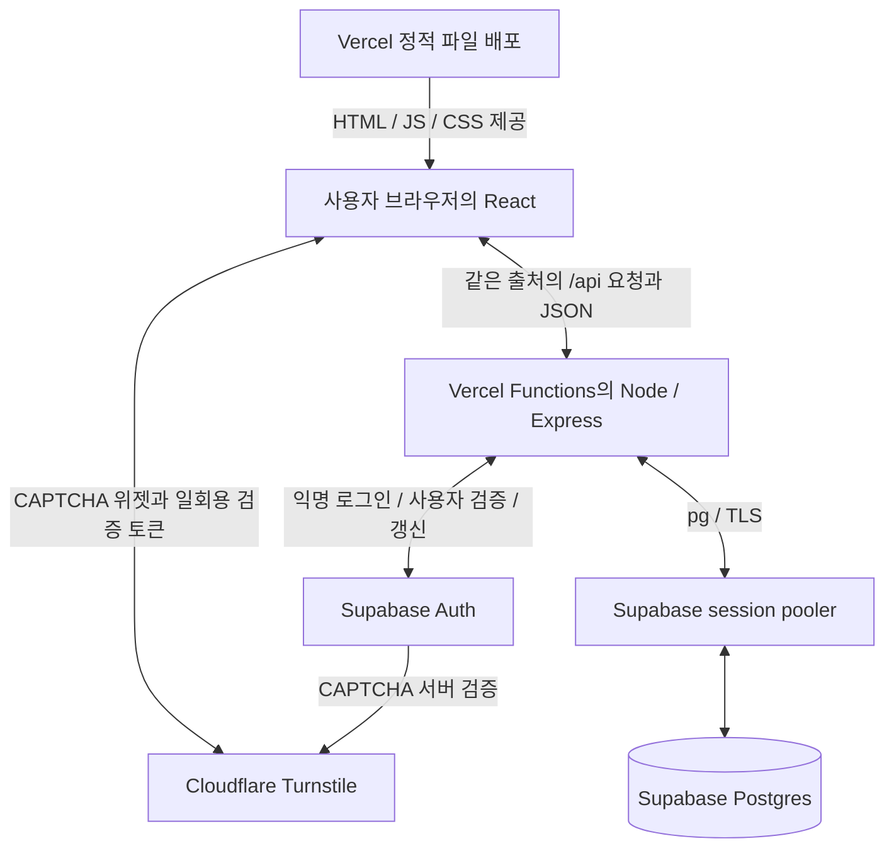
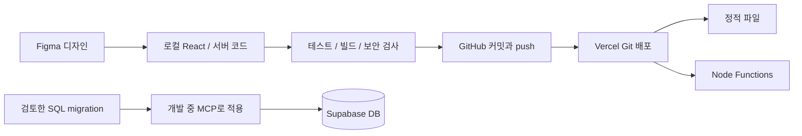
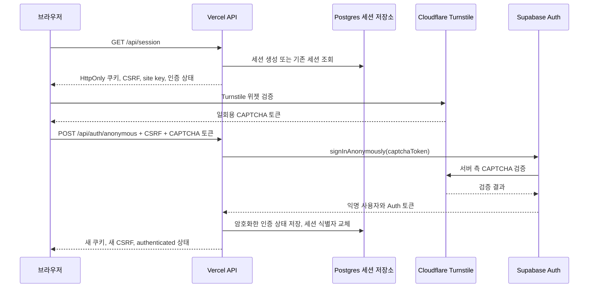

# figma-calendar 학습 가이드: 설계부터 배포·운영까지

작성 기준: 2026-10-09 · 현재 소스 코드와 기존 구현·배포 검증 기록 기준

이 프로젝트는 **Figma 화면을 웹으로 구현한 뒤, 브라우저 내부 저장을 서버·DB 저장으로 확장하고, 익명 인증을 붙여 Vercel에 공개한 공유 캘린더**다. 현재 프런트엔드는 브라우저에서, 백엔드는 Vercel Functions에서 실행된다. Supabase는 인증과 Postgres 데이터 저장을 담당하고, Cloudflare Turnstile은 입장 시 CAPTCHA를 제공한다.

이 문서는 처음부터 현재 구조를 모두 계획했다고 가정하지 않는다. 초기 계획과 요구사항이 확장된 과정을 구분하고, 현재 코드를 따라가며 각 선택의 이유를 설명한다. 검증 결과는 기존 기록을 인용하며, 문서 작성만으로 배포·DB 검사를 새로 수행했다고 간주하지 않는다.

- 공개 앱: [codex-vibecoding-seven.vercel.app](https://codex-vibecoding-seven.vercel.app/)
- 소스 저장소: [TaeyoungYou/codex-vibecoding](https://github.com/TaeyoungYou/codex-vibecoding) 안의 `figma-calendar/`
- 빠른 실행 안내: [README](../README.md)
- 실제 검사 결과: [검증 기록](verification.md)

## 1. 이 프로젝트에서 배우는 것

다음 질문에 답할 수 있으면 전체 흐름을 이해한 것이다.

1. 화면 디자인에서 기능 요구사항과 구현 계획을 어떻게 뽑는가?
2. React 코드, API 코드, DB 코드는 각각 어디에서 실행되는가?
3. `api` 파일에 한 줄만 있어도 백엔드가 배포되는 이유는 무엇인가?
4. CAPTCHA, 사용자 인증, 앱 세션, DB 접속 계정은 어떻게 다른가?
5. 로컬에서 되던 서버를 공개 배포할 때 무엇을 다시 설계해야 하는가?
6. 빌드 성공과 사용자가 실제로 기능을 쓰는 것을 어떻게 구분해 검증하는가?

학습 순서는 **요구사항 → 화면·상태 → API 계약 → DB → 인증 → 배포 → 검증·운영**으로 잡으면 좋다. 기능을 한 단계씩 완성하고, 그 단계의 완료 조건을 확인한 뒤 다음 단계로 넘어간다.

### 먼저 알아둘 용어

| 용어 | 이 앱에서의 의미 |
| --- | --- |
| 프런트엔드 | 브라우저에서 실행되는 React 화면과 사용자 상호작용 |
| 백엔드 | 요청을 검사하고 인증·DB 작업을 처리하는 Node.js/Express 코드 |
| API | 화면과 서버가 약속한 요청 경로, 입력, 응답 형식 |
| 빌드 | 개발용 코드를 실행·배포할 파일로 변환하는 작업 |
| 배포 | 정적 파일과 서버 실행 코드를 호스팅 환경에 올리는 작업 |
| Function | Vercel이 관리하는 서버 실행 단위. HTTP 요청을 받아 백엔드 코드를 실행한다 |
| Auth | 사용자 인증 서비스. 이 앱에서는 Supabase 익명 인증을 사용한다 |
| 세션 | 여러 요청을 같은 브라우저의 인증 상태와 연결하는 서버 측 상태 |
| 쿠키 | 브라우저가 같은 사이트에 요청할 때 자동으로 보내는 값. 여기서는 불투명한 세션 식별자 |
| CSRF 토큰 | 외부 사이트가 사용자의 쿠키를 악용해 쓰기 요청을 보내는 것을 막는 추가 확인 값 |
| RLS | Postgres에서 어떤 역할이 어떤 행에 접근할지 제한하는 정책 |
| Pooler | DB 연결을 중개하는 서비스. 이 프로젝트는 확인된 Supabase session pooler를 사용한다 |

## 2. 무엇을 만들기로 했고, 어떻게 확장했는가?

### 현재 요구사항

- 월별 달력을 표시하고 날짜를 선택한다.
- 선택한 날짜의 일정 제목을 조회·추가·삭제한다.
- 인증한 브라우저들이 **하나의 캘린더를 공유**한다.
- Turnstile을 완료한 뒤 이메일 입력 없이 익명으로 입장한다.
- 저장 실패·인증 만료·연결 장애를 화면에서 구분하고, 작성 중인 입력을 가능한 한 보존한다.
- 모바일 화면과 키보드 사용을 지원한다.

현재 일정에는 사용자별 소유자 구분이 없다. 인증한 사용자는 공유 일정의 조회·추가·삭제가 가능하다. 개인 캘린더로 바꾸려면 `owner_id`, API 권한 검사, DB 정책까지 새로 설계해야 한다.

### 실제 진행 단계와 각 단계의 학습 목표

| 단계 | 계획·구현한 일 | 배운 개념 | 완료 조건 |
| --- | --- | --- | --- |
| 1. 디자인 해석 | Figma의 두 화면을 기준으로 달력과 일정 카드 설계 | 디자인을 컴포넌트·간격·글꼴·상태로 나누기 | 화면 구성과 기능 범위 합의 |
| 2. 초기 웹 구현 | HTML/CSS/JavaScript와 `localStorage` 중심 계획 | 날짜 계산, DOM, 브라우저 저장 | 날짜 선택과 일정 추가·삭제 동작 |
| 3. 공유 앱으로 확장 | React/Vite, Express API, Supabase Postgres 도입 | 화면 상태, HTTP, 서버와 DB의 책임 | 새로고침·다른 브라우저에서도 서버 데이터 조회 |
| 4. 인증·보안 | Turnstile, 서버 전용 Supabase Auth, 세션·CSRF·권한 검사 | CAPTCHA와 인증의 차이, 신뢰 경계 | 미인증 접근 차단과 정상 사용자 CRUD |
| 5. 공개 배포 적응 | Vercel API 진입점, DB 공유 세션, HTTPS 설정, 주기적 조회 | 서버 실행 환경과 수명, 여러 인스턴스 | 공개 주소에서 로그인·조회·추가·삭제 |
| 6. 운영 검증 | 테스트·실제 DB·공개 로그·사용자 브라우저 확인 | 증거에 따른 디버깅, 검증 범위 구분 | 실제 기능 확인과 미검증 항목 기록 |

초기 vanilla JavaScript·`localStorage` 설계는 [당시 설계서](superpowers/specs/2026-10-07-calendar-design.md)와 [구현 계획](superpowers/plans/2026-10-07-calendar-implementation.md)에 남아 있다. 현재 동작을 확인할 때는 최신 코드와 README를 우선한다. 지금은 일정 저장에 `localStorage`를 사용하지 않는다.

### 같은 앱을 다시 만든다면 세울 계획

기능마다 **입력 → 처리 → 저장 → 화면 반영 → 실패 시 행동**을 먼저 적는다. 예를 들어 일정 추가는 다음처럼 계획할 수 있다.

| 항목 | 계획 |
| --- | --- |
| 사용자 입력 | 선택한 날짜, 제목 |
| 화면 검사 | 날짜 선택 여부, 빈 제목, 저장 중 중복 클릭 |
| 서버 검사 | 인증·CSRF, 실제 날짜, UUID, 제목 길이, 허용 필드 |
| 저장 | 서버가 검증한 값만 매개변수 SQL로 INSERT |
| 성공 | 목록 갱신, 입력 초기화 |
| 실패 | 오류 안내, 초안과 재시도용 UUID 유지 |
| 검증 | 정상 추가, 중복 제출, 잘못된 날짜, DB 장애 |

이렇게 작성하면 화면만 완성한 상태와 기능 전체를 완성한 상태를 구분할 수 있다.

## 3. 각 플랫폼의 역할과 연결

| 플랫폼·도구 | 실제 역할 | 연결되는 대상 |
| --- | --- | --- |
| Figma | 화면 디자인의 기준 | 개발자가 디자인을 읽고 React/CSS로 구현 |
| GitHub | 소스·설정·migration·문서의 버전 관리 | 연결된 Vercel 프로젝트의 Git 배포 |
| Vercel 정적 호스팅 | Vite가 만든 HTML/JS/CSS/폰트/SVG 제공 | 사용자 브라우저 |
| Vercel Functions | Node.js/Express API 실행 | 브라우저, Supabase Auth, Supabase DB pooler |
| Supabase Auth | CAPTCHA를 포함한 익명 로그인, 사용자·토큰 검증·갱신 | 서버의 Supabase SDK, Turnstile 검증 서비스 |
| Supabase Postgres | 공유 일정, 운영 세션, 요청 횟수 저장 | 서버의 `pg` 연결 |
| Cloudflare Turnstile | CAPTCHA 위젯과 검증 서비스 | 브라우저 위젯, Supabase Auth의 서버 측 검증 |
| Codex·MCP·CLI | 개발 중 코드 수정, 설정 조회, migration 적용, 배포·로그 점검 | 각 플랫폼의 관리 기능 |

Figma와 MCP는 사용자가 캘린더를 사용하는 동안의 실행 경로에 들어가지 않는다. GitHub도 매번 API 요청을 중계하지 않는다. 이 프로젝트의 백엔드 실행 위치는 **Vercel Functions**이며 Supabase Edge Functions에 별도 API를 배포한 구조는 아니다.

Cloudflare에 추가한 호스트 이름은 Turnstile 위젯의 사용 허용 설정이다. 이 설정으로 앱 호스팅이나 DNS가 Cloudflare로 이전되지는 않는다. [Turnstile 호스트 이름 관리 안내](https://developers.cloudflare.com/turnstile/additional-configuration/hostname-management/)

### 사용 중 연결: 런타임 구조



브라우저가 직접 보내는 데이터 요청은 앱의 `/api/...`로 향한다. 일정은 서버의 `pg`를 통해 저장하며, 브라우저에서 Supabase Data API나 Supabase Realtime을 직접 구독하지 않는다.

### 만드는 동안의 연결: 개발·배포 구조



**Vercel 배포와 DB migration 적용은 별개 작업**이다. GitHub에 SQL 파일을 올렸다고 운영 DB에 자동 적용되지는 않는다. 현재 저장소에는 그 자동 실행 파이프라인을 구성하지 않았다.

## 4. 파일은 어떤 책임으로 나누었는가?

아래 경로는 모두 `figma-calendar/` 기준이다.

```text
figma-calendar/
├─ client/                  브라우저 화면과 공개 자산
│  └─ src/
│     ├─ App.jsx            달력·날짜 선택·일정 UI 상태
│     ├─ AuthGate.jsx       인증 화면과 Turnstile 위젯
│     ├─ api.js             같은 출처 API 호출과 동기화
│     └─ dates.js           날짜 계산·검증용 순수 함수
├─ api/                     Vercel이 찾는 HTTP 함수 진입점
│  ├─ session.js
│  ├─ auth/anonymous.js
│  ├─ events.js
│  ├─ events/[id].js
│  └─ changes.js
├─ server/                  실제 백엔드 구현
│  ├─ index.js              로컬 Node 서버 시작
│  ├─ app.js                로컬 Express 앱·세션·요청 방어
│  ├─ vercel.js             Vercel handler와 운영 설정
│  ├─ web-app.js            Vercel용 Express 요청 처리
│  ├─ web-sessions.js       DB 공유 세션·암호화·요청 한도
│  ├─ auth.js               Supabase 익명 Auth·검증·갱신
│  ├─ repository.js         일정 SQL과 DB 권한 검사
│  ├─ validation.js         날짜·제목·UUID 입력 검사
│  ├─ config.js             서버 환경 설정 검사
│  ├─ changes.js            로컬 LISTEN/SSE 동기화
│  └─ certs/                Vercel에 포함할 공개 CA 인증서
├─ supabase/migrations/     DB 구조·권한 변경 이력
├─ tests/                   자동 테스트
├─ scripts/                 로컬 설정·DB·보안 검사 도구
├─ docs/                    설계·학습·운영·검증 문서
├─ memory-bank/             프로젝트 진행·이슈 기록
├─ dist/                    Vite가 생성하는 프런트엔드 결과
├─ vite.config.js           프런트엔드 빌드·개발 설정
├─ vercel.json              함수·정적 배포·헤더 설정
└─ .env.server.example      값 입력 전의 서버 설정 양식
```

책임을 나누면 문제를 좁히기 쉽다. 날짜 표시 문제는 `dates.js`와 화면에서, HTTP 입력 문제는 `web-app.js`·`validation.js`에서, SQL·권한 문제는 `repository.js`와 migration에서 조사한다.

## 5. api에 한 줄만 있는데 백엔드는 어떻게 배포되는가?

실제 [api/events.js](../api/events.js)는 다음과 같다.

```js
export { default } from '../server/vercel.js';
```

이 코드는 `server/vercel.js`의 기본 내보내기인 HTTP handler를 이 경로의 handler로 다시 내보낸다. 호출 관계는 다음과 같다.

```text
GET /api/events?date=2026-10-09
  → api/events.js
  → server/vercel.js의 handler
  → server/web-app.js의 Express 처리
  → server/auth.js로 인증 확인
  → server/repository.js로 SQL 실행
  → JSON 응답
```

Vercel은 `api` 진입점과 그 코드가 import하는 서버 모듈·필요한 의존성을 함수 실행 파일로 묶는다. 그래서 API 폴더에 모든 로직을 복사할 필요가 없다. 이 프로젝트는 Node의 `req, res` handler 형식을 사용한다. [Vercel Node.js 런타임 안내](https://vercel.com/docs/functions/runtimes/node-js)

현재 구조에서는 **한 번의 프로젝트 배포에 두 종류의 결과가 생긴다.**

| 배포 결과 | 만들어지는 과정 | 실행·제공 위치 |
| --- | --- | --- |
| 프런트엔드 정적 파일 | Vite가 `client`를 빌드해 `dist` 생성 | Vercel이 제공하고 브라우저가 JS 실행 |
| 백엔드 함수 | Vercel이 `api`와 연결된 `server` 코드·의존성을 패키징 | Vercel Node.js 런타임 |

`npm run build` 자체는 Vite 프런트엔드 빌드다. 백엔드 함수 패키징은 Vercel 배포 과정이 담당한다. 따라서 **`dist`만 업로드하면 현재 앱의 백엔드가 포함되지 않는다.** 배포 입력에는 `api`, `server`, `package.json`, lockfile, `vercel.json` 등 필요한 프로젝트 소스·설정이 있어야 한다.

`server/index.js`에서 로컬 서버를 켜는 방식과 달리, 현재 Vercel 경로는 `server/vercel.js`의 handler를 실행한다. 서버 코드는 브라우저 번들에 들어가지 않으며 `/server/auth.js` 같은 URL로 공개되지 않는다.

### 배포 확인에서 발견한 5개 함수

```text
api/auth/anonymous
api/changes
api/events
api/events/[id]
api/session
```

파일 진입점은 5개지만 HTTP 동작은 더 많다. `api/events` 함수가 GET과 POST를 함께 처리하기 때문이다. 각 함수는 같은 서버 구현을 재사용하며, 요청이 항상 같은 실행 인스턴스로 간다고 가정하지 않는다.

## 6. 화면은 어떻게 만들고 상태를 관리했는가?

디자인을 구현할 때는 색·글꼴·간격·카드·버튼 상태를 먼저 정리하고, 달력과 일정 카드로 분리했다. 기존 Inter 글꼴·SVG 자산과 BEM CSS 규칙을 유지했다. 화면이 좁아질 때 카드와 Turnstile 위젯이 넘치지 않도록 확인했다.

[App.jsx](../client/src/App.jsx)의 핵심 상태는 표시 중인 월, 선택 날짜, 일정 목록, 제목 초안, 조회·쓰기 진행, 오류다. 상태가 바뀌면 React가 그 상태에 맞는 화면을 다시 그린다.

- 날짜는 `YYYY-MM-DD`의 **날짜 값**으로 다룬다. 불필요하게 UTC 시각으로 바꾸면 시간대에 따라 날짜가 하루 달라질 수 있다.
- 달력은 월에 따라 4·5·6주가 되고, 앞뒤 달의 빈 칸은 선택할 수 없다.
- 날짜를 바꾼 뒤 이전 날짜의 늦은 응답이 도착해도 새 화면을 덮어쓰지 않도록 요청 취소·응답 무시를 처리한다.
- 조회 장애가 발생해도 작성 중인 입력과 초점을 유지한다. 데이터가 복구되기 전에는 쓰기를 잠근다.
- 제목은 React 텍스트로 출력한다. 사용자가 입력한 문자열을 HTML로 실행하지 않는다.

학습 포인트는 정상 화면뿐 아니라 **로딩·빈 목록·오류·인증 만료·복구 화면도 설계 대상**이라는 점이다.

## 7. CAPTCHA부터 로그인까지의 흐름

CAPTCHA는 자동화된 남용을 줄이기 위한 검증이고, Auth는 사용자와 인증 토큰을 관리한다. 앱 세션은 그 인증 결과를 브라우저의 여러 요청에 연결한다.



Supabase에 설정한 Turnstile secret으로 Supabase Auth가 CAPTCHA를 검증한다. 앱에 같은 secret을 다시 넣거나 앱에서 별도 Siteverify 우회 경로를 만들지 않았다. [Supabase CAPTCHA 안내](https://supabase.com/docs/guides/auth/auth-captcha)

로그인 후 보호 API는 [auth.js](../server/auth.js)에서 `getUser(accessToken)`으로 실제 인증 서버에 사용자 상태를 확인하고, 익명 사용자 여부와 앱의 만료 상한을 검사한다. 토큰 만료가 가까우면 갱신하되, 앱에서 정한 최대 1시간을 계속 연장하지 않는다. [getUser 공식 문서](https://supabase.com/docs/reference/javascript/auth-getuser)

### 이름이 비슷한 값들을 구분하기

| 값 | 보관·이동 위치 | 목적 |
| --- | --- | --- |
| Turnstile site key | 서버 설정 → 브라우저 | 공개 CAPTCHA 위젯 식별 |
| CAPTCHA 토큰 | 브라우저 → 앱 서버 → Supabase Auth | 이번 로그인 시도의 CAPTCHA 결과 전달 |
| Turnstile secret | Supabase Auth 설정 | CAPTCHA 서버 검증 |
| Auth access/refresh token | 서버 내부, Vercel에서는 암호화한 DB 세션 | 사용자 검증·토큰 갱신 |
| 앱 세션 쿠키 | 브라우저 → 같은 출처의 API | 서버 세션 식별. Auth 토큰 자체가 아니다 |
| CSRF 토큰 | 응답 → 클라이언트 메모리 → 쓰기 헤더 | 앱 화면에서 시작한 쓰기 요청인지 추가 확인 |
| DB 역할·비밀번호 | 서버 → DB pooler | SQL 연결 권한. 사용자 로그인 토큰과 별개 |

익명 로그인도 Supabase Auth에 사용자 레코드를 생성한다. 앱 세션이 만료된다고 계정이 자동 삭제되지는 않는다. Supabase의 익명 사용자는 인증 후 `authenticated` 역할을 갖는 개념이며, 미로그인 요청용 `anon`과 다르다. 다만 이 앱의 SQL은 별도 `calendar_runtime` 역할로 실행한다. [익명 인증 공식 문서](https://supabase.com/docs/guides/auth/auth-anonymous), [계정 수동 관리](auth-operations.md)

## 8. 일정 조회·추가·삭제의 전체 경로

### API 계약

| 요청 | 입력 | 정상 결과 |
| --- | --- | --- |
| `GET /api/session` | 기존 세션 쿠키가 있으면 함께 전달 | 200: 인증 상태·CSRF·site key·동기화 방식 |
| `POST /api/auth/anonymous` | JSON `{ captchaToken }`, CSRF | 200: 인증된 세션 |
| `GET /api/events?date=YYYY-MM-DD` | 인증된 쿠키, 날짜 | 200: `{ events: [...] }` |
| `POST /api/events` | 인증·CSRF, JSON `{ id, date, title }` | 201: `{ event: ... }` |
| `DELETE /api/events/{id}?date=YYYY-MM-DD` | 인증·CSRF, JSON `{}` | 200: `{ removed: true 또는 false }` |
| `GET /api/changes` | 인증된 쿠키 | 로컬: SSE / Vercel: 상태 JSON |

아래는 입력 형태를 보여주는 예시이며, 그대로 실행하는 운영 데이터 변경 명령이 아니다.

```json
{
  "id": "c0fe2f53-df72-4a25-8027-415aaef908bb",
  "date": "2026-10-09",
  "title": "학습용 일정"
}
```

일정 추가는 **React 입력 → `api.js` → `/api/events` → 요청·인증 검사 → 입력 검증 → `repository.js` → Postgres → JSON → 화면 반영** 순서다. 화면 검사는 사용 편의를 위한 것이고, 서버는 요청을 별도로 검증한다.

### DB 구성

| 테이블 | 저장 내용 | 앱에서의 역할 |
| --- | --- | --- |
| `calendar_private.events` | `id`, `event_date`, `title`, `created_at` | 실제 공유 일정 |
| `calendar_private.web_sessions` | 쿠키 해시, CSRF, 암호화한 인증 상태, 만료 시각 | Vercel 함수 사이의 세션 공유 |
| `calendar_private.web_limits` | 요청 제한 구간, 횟수, 만료 시각 | 함수 사이의 요청 한도 공유 |

`repository.js`는 SQL 값에 `$1`, `$2` 같은 매개변수를 사용한다. 사용자 제목을 SQL 문장에 직접 이어 붙이지 않는다. DB 역할은 `events`의 SELECT·INSERT·DELETE만 허용하고 UPDATE·DDL 등은 차단한다. 운영 세션·한도 테이블에는 상태 갱신을 위한 UPDATE도 허용한다.

RLS와 FORCE RLS를 적용하고 private schema는 Data API에 공개하지 않았다. 현재 RLS는 지정한 서버 역할의 접근을 허용하는 정책이며, 사용자별 일정 소유권을 나누지 않는다. **HTTP 사용자 인증은 Express가, DB 역할 권한은 Postgres가 검사한다.** 관리자 MCP로 조회가 된다는 사실만으로 앱의 최소 권한 연결까지 검증된 것은 아니다.

### UUID와 재시도

일정을 추가할 때 클라이언트가 UUID를 만든다. 응답을 받지 못해 같은 작업을 재시도하면 동일한 UUID를 사용한다. 서버는 같은 ID·내용이면 기존 일정을 반환하고, 내용이 다르면 충돌로 처리한다. 이 성질을 **멱등성**이라고 하며, 통신 오류로 같은 일정이 여러 번 저장되는 것을 줄인다.

삭제도 ID와 날짜를 함께 검사한다. 이미 없는 일정의 반복 삭제는 `removed: false`로 처리하지만, 존재하는 ID가 다른 날짜에 속하면 충돌로 거부한다.

## 9. 로컬 서버를 Vercel에 맞게 바꾼 이유

| 항목 | 로컬 실행 | 현재 Vercel 실행 | 바꾼 이유 |
| --- | --- | --- | --- |
| 시작점 | `server/index.js`로 Node 서버 시작 | `api/*` → `server/vercel.js` handler | 호스팅 환경의 진입점에 맞추기 |
| 주소 | `http://127.0.0.1:4175` | 공개 HTTPS 주소 | 정확한 Host·Origin 검사 필요 |
| 세션 | 프로세스 메모리 | DB 공유 저장소 | 요청이 다른 함수 인스턴스에 가도 인증 유지 |
| Auth 토큰 | 서버 메모리 | AES-256-GCM으로 암호화한 DB 값 | 공유 저장하면서 원문 토큰 노출 줄이기 |
| DB 연결 | Pool 최대 2 + 전용 LISTEN 1 | 요청별 짧은 연결, 응답 전에 종료 | 함수마다 연결 풀이 누적되는 문제 줄이기 |
| 변경 감지 | Postgres LISTEN → SSE → 재조회 | 약 5초 주기로 세션 확인·일정 재조회 | 상주 연결과 백그라운드 작업에 의존하지 않기 |
| 쿠키 | HttpOnly·SameSite=Strict | 여기에 Secure 추가 | HTTPS 연결로만 전달 |
| 설정 | 보호한 `.env.server.local` | Vercel 서버 환경 변수 | 실행 환경별 안전한 설정 주입 |

Vercel 함수가 메모리를 재사용하는 경우는 있어도, 그 메모리가 영구적이거나 모든 요청에 공유된다고 가정하면 안 된다. 현재 코드는 앱 객체를 재사용할 수 있게 두고, 중요한 인증·한도 상태는 DB에 둔다.

쿠키 원문은 DB에 저장하지 않고 SHA-256 해시로 찾는다. Auth 토큰은 세션 행에 연결된 인증 암호화로 저장하고, 같은 세션의 동시 요청은 DB 행 잠금으로 처리 순서를 조정한다. 암호화 키를 바꾸면 기존 인증 상태를 다시 읽을 수 없어 재인증이 필요하다.

로컬 SSE는 변경 알림을 받은 뒤 최신 목록을 다시 읽는다. Vercel의 주기적 조회는 즉시 전파를 보장하지 않으며, 네트워크 지연·백그라운드 탭 제한에 따라 더 늦어질 수 있다. 현재 DB 역할 연결 한도는 4, 앱 세션 한도는 128이다. 이 수치가 동시 사용자 128명의 성능을 검증했다는 뜻은 아니다.

## 10. 환경 변수와 비밀은 어디에 두는가?

### 설정 소유 위치

| 설정 | 로컬 | 운영 | 공개 여부·주의 |
| --- | --- | --- | --- |
| `CALENDAR_DB_HOST`, `PORT`, `USER` | 서버 env | Vercel env | 연결 식별 정보이며 비밀번호와 함께 서버에서 사용 |
| `CALENDAR_DB_PASSWORD` | 보호한 서버 env | Vercel env | 비밀. Git·브라우저·로그 제외 |
| `CALENDAR_SUPABASE_URL` | 서버 env | Vercel env | Auth 프로젝트 주소 |
| `CALENDAR_SUPABASE_PUBLISHABLE_KEY` | 서버 env | Vercel env | publishable key 자체는 공개 사용 용도지만 이 앱에서는 서버 SDK만 사용 |
| `CALENDAR_TURNSTILE_SITE_KEY` | 서버 env | Vercel env | 위젯에 전달하는 공개 키 |
| `CALENDAR_ORIGIN` | 로컬은 고정 loopback | Vercel env | 허용할 정확한 HTTPS 출처 |
| `CALENDAR_SESSION_SECRET` | 현재 로컬 경로에서는 불필요 | Vercel env | 32바이트 무작위 키를 base64url로 표현한 비밀 |
| `CALENDAR_DB_CA_CERT_PATH` | 로컬 공개 CA 경로 | 함수가 번들 내부 경로로 지정 | CA는 공개 인증서이며 비밀번호가 아니다 |
| Turnstile secret | Supabase Auth 설정 | Supabase Auth 설정 | 앱 env에 별도로 넣지 않음 |
| Turnstile 허용 호스트 | Cloudflare 위젯 설정 | Cloudflare 위젯 설정 | 운영 호스트 이름 등록 |

Vercel의 필수 서버 설정은 DB 4개 + Auth/위젯 3개 + Origin/세션 키 2개다. 로컬 CA 경로를 그대로 운영에 복사하는 대신, [vercel.json](../vercel.json)의 `includeFiles`로 `server/certs/**`를 함수에 포함한다.

### .env.server.example은 GitHub에 올려도 되는가?

**현재처럼 실제 비밀 값을 비워 둔 설정 양식은 올려도 된다.** 개발자가 필요한 변수 이름과 값의 형식을 이해하도록 돕는다. 공개 호스트·프로젝트 URL·site key와 비밀인 DB 비밀번호·세션 암호화 키를 구분해야 한다.

실제 값이 있는 `.env.server.local`은 Git에서 제외하고 파일 접근 권한을 제한한다. 이름에 `.example`이 붙었더라도 실제 비밀번호나 secret을 넣으면 공개하면 안 된다.

`VITE_*` 환경 변수는 프런트엔드 번들에 포함될 수 있다. 이 앱의 DB 비밀번호와 세션 키에 `VITE_` 접두사를 붙이지 않는다. Vercel env를 바꾼 뒤에는 변경 값을 사용하는 새 배포가 필요하다. [Vite 환경 변수](https://vite.dev/guide/env-and-mode), [Vercel 환경 변수](https://vercel.com/docs/environment-variables)

## 11. 평소 개발·수정·배포 워크플로우

### 11-1. 요구사항과 현재 상태 확인

1. 변경할 사용자 행동을 한 문장으로 적는다. 예: “일정 삭제를 누르면 목록에서 사라지고 새로고침 후에도 없어야 한다.”
2. README·작업 지침·진행·이슈 문서를 읽고, 해당 기능의 화면 → API → DB 경로를 찾는다.
3. UI만 바꾸는지, API 계약·DB 구조·환경 설정도 바뀌는지 정한다.
4. 정상 동작과 실패 동작의 완료 조건을 적는다.

### 11-2. 로컬 실행과 구현

현재 작업 환경은 초기 설정이 완료되어 있다. 실행을 위해 DB 비밀번호 설정을 다시 할 필요는 없다. 새 PC의 초기 설정은 [README](../README.md)를 따른다. `setup:db`는 실제 역할 비밀번호를 바꾸는 작업이므로 단순 실행 준비와 구분한다.

```powershell
cd C:\Study\Codex\codex-vibecoding\figma-calendar
npm.cmd ci
npm.cmd run dev
```

앱은 `http://127.0.0.1:4175`에서 확인한다. `npm ci`는 의존성 최초 설치 또는 lockfile 변경 시 수행한다. 개발 서버를 종료한 뒤 빌드 실행을 확인하려면 다음을 사용한다.

```powershell
npm.cmd run build
npm.cmd start
```

이때도 `npm start`는 로컬 Express 서버를 실행한다. 로컬의 `npm start` 성공이 Vercel 함수의 정상 동작을 대신 검증하지는 않는다.

### 11-3. 변경 범위에 맞게 검증

기능·인증·배포 설정을 바꿨을 때 필요한 검사를 선택한다.

```powershell
npm.cmd test
npm.cmd run lint
npm.cmd run build
npm.cmd run check:security
npm.cmd run check:db
npm.cmd audit
git diff --check
```

`check:db`는 실제 설정된 DB에 연결해 트랜잭션 안에서 권한·CRUD를 검사하고 테스트 변경을 rollback한다. 일반 UI 확인과 구분해서 실행한다. 문서만 바꿨다면 링크·형식·비밀 유출 검사처럼 그 변경에 맞는 확인이면 된다.

### 11-4. DB 변경이 있다면 migration을 별도로 관리

1. Supabase CLI의 `migration new`로 새 파일을 만든다.
2. 테이블·인덱스·grants·RLS 정책과 기존 데이터 영향을 함께 검토한다.
3. 개발 중 Supabase MCP로 검토한 migration을 적용한다.
4. 원격 적용 버전과 SQL이 로컬 migration 기록과 일치하는지 대조한다.
5. 실제 런타임 역할로 권한을 확인하고 Advisor도 점검한다.

이미 적용한 migration은 수정·삭제하지 않는다. 잘못된 부분은 새 migration으로 보정한다. 앱 배포를 이전 버전으로 돌려도 DB 변경은 자동으로 되돌아가지 않으므로, 앱과 schema의 호환성도 계획해야 한다.

### 11-5. GitHub에 변경을 올리고 Vercel 배포 확인

1. `git status`·`git diff`로 변경 내용을 검토하고 필요한 파일만 선택한다.
2. 소스와 함께 `api`, `server`, `vercel.json`, lockfile 등 변경된 필수 설정의 누락을 확인한다.
3. 선택한 변경을 커밋하고 연결된 브랜치에 push한다.
4. 현재 연결된 GitHub `main`의 변경은 Vercel Production 배포로 이어진다.
5. 배포의 커밋·환경·빌드 로그·함수 목록을 확인한다.
6. 공개 주소에서 CAPTCHA → 입장 → 조회 → 임시 일정 추가 → 삭제 → 새로고침을 확인한다.
7. 로그와 화면 결과를 함께 보고 검증 문서를 갱신한다.

처음 복구 때는 CLI로 소스를 배포했고, 이후 GitHub 자동 배포로 연결했다. 앞으로 수동 배포를 한다면 로컬 디렉터리의 Vercel 연결과 서버의 Root Directory가 같은 소스를 가리키는지 먼저 확인한다. [Vercel 배포 안내](https://vercel.com/docs/deployments)

현재 API는 운영 Origin을 정확히 검사한다. 새 Preview 주소가 생겨도 자동으로 허용되지는 않는다. Preview에서 인증까지 시험하려면 그 환경의 Origin·Turnstile 허용 호스트·Supabase 테스트 설정을 함께 준비해야 한다.

## 12. 플랫폼별로 어디를 확인하는가?

| 확인 대상 | 확인 위치 | 확인할 내용 |
| --- | --- | --- |
| Git 소스 | [GitHub 저장소](https://github.com/TaeyoungYou/codex-vibecoding) | 배포 커밋에 필요한 파일이 모두 있는가 |
| Vercel 프로젝트 | [codex-vibecoding](https://vercel.com/gukbaps-projects/codex-vibecoding) | 올바른 팀·프로젝트인가 |
| 빌드 설정 | Vercel Project → Settings | Root Directory=`figma-calendar`, Vite, Node 24.x |
| 배포 결과 | Project → Deployments → 해당 배포 | 커밋, 환경, 빌드 성공, 정적 파일·함수 |
| 함수 목록 | 선택한 배포의 Resources / Functions 또는 Deployment Summary | 5개 API 진입점이 패키징되었는가 |
| 실행 로그 | Vercel Project → Logs | API 경로·메서드·응답 코드·실행 오류 |
| 서버 설정 | Vercel Project → Settings → Environment Variables | 올바른 환경에 변수 등록 후 새로 배포했는가 |
| Auth 설정 | Supabase `calendar-app` → Authentication | 익명 로그인, CAPTCHA 설정, 익명 사용자 |
| DB 구조·권한 | Supabase DB 및 migration 기록 | private 테이블·역할·정책·원격 적용 이력 |
| CAPTCHA | Cloudflare → Turnstile → 해당 위젯 | site key와 secret의 짝, 운영 허용 호스트 |

`vercel.json`의 `maxDuration: 30`은 함수 실행 제한 설정이고, 화면의 약 5초 조회 주기는 클라이언트 동기화 설정이다. 서로 다른 값이다. `regions: ["iad1"]`도 현재 함수 배치 설정이며 DB 위치를 변경하지 않는다.

Vercel의 함수 목록·로그 UI는 변경될 수 있다. 조회 경로의 현재 공식 설명은 [배포 Resources 안내](https://vercel.com/docs/deployments#resources-tab-and-deployment-summary)와 [런타임 로그 안내](https://vercel.com/docs/logs/runtime)를 참고한다.

## 13. 이번 배포 문제를 통해 배운 디버깅 방식

| 증상 | 확인한 원인·상황 | 해결·학습 포인트 |
| --- | --- | --- |
| 화면은 200인데 `/api/*`는 404 | Vite 화면만 배포되고 API 함수 진입점이 없음 | 정적 파일과 백엔드 배포 결과를 따로 확인하고 `api` 진입점 추가 |
| 로컬에서는 되지만 공개 환경에서 거부 | loopback 전용 Host·Origin 검사 | 배포 환경의 정확한 HTTPS 출처로 구성 |
| 여러 함수에서 인증 유지가 어려움 | 프로세스별 메모리 세션은 공유되지 않음 | DB 세션·요청 한도 저장소와 토큰 암호화 도입 |
| Git 자동 배포 후 API 503 | 필요한 `vercel.json`이 커밋에서 빠져 공개 CA 포함 설정 등이 누락 | 필수 배포 설정도 버전 관리하고 실제 API까지 재검증 |
| 일정 추가는 되는데 삭제는 400 | Vercel 동적 경로의 `id`가 쿼리에도 포함되어 날짜 전용 검사와 충돌 | 경로 UUID와 같은 단일 `id`만 허용. 중복·불일치·다른 쿼리는 계속 거부 |
| 자동화 브라우저 CAPTCHA 600010 | 자동화 환경에서 실제 Turnstile 검증 실패 | 일반 브라우저 실사용 확인과 격리된 자동 테스트를 구분 |
| Vercel MCP 상세 조회 403 | 해당 상세 조회의 팀 권한 제한 | 같은 계정·프로젝트의 공식 CLI로 허용된 조회 수행 |

삭제 문제는 [web-app.js](../server/web-app.js)의 `dateQuery`와 실제 공개 POST·DELETE 로그를 연결해서 찾았다. “입력 검사를 전부 풀기” 대신, 플랫폼이 추가하는 값의 형태를 좁혀 허용했다. 자세한 변경 기록은 [Vercel 배포 점검](vercel-deployment-review.md)에 있다.

### 오류 코드를 읽는 순서

`404`는 경로·배포 결과, `400`은 입력·쿼리 형식, `401`은 인증 상태, `403`은 Origin·CSRF 같은 요청 조건, `429`는 요청 한도, `503`은 설정·의존 서비스 연결을 먼저 확인한다. 같은 코드라도 앱의 JSON `code`와 실행 로그를 함께 봐야 한다.

미인증 일정 요청의 401은 의도한 차단이다. 또 이 앱은 `Sec-Fetch-Site: same-origin` 등 요청 조건을 검사하므로, API 주소를 주소창에 직접 입력하거나 헤더 없는 단순 요청으로 받은 403만으로 장애라고 판단하면 안 된다. 앱 화면에서 발생한 Network 요청과 비교한다.

### 자동화 테스트와 공식 Turnstile 테스트 키

Cloudflare는 항상 성공·실패하는 공식 테스트 키를 제공한다. 자동화 검증에 사용할 수 있으며, 운영 위젯의 허용 호스트에 테스트 키를 등록하는 방식은 아니다. 테스트 site key와 대응하는 test secret을 함께 써야 한다. [공식 테스트 키와 동작](https://developers.cloudflare.com/turnstile/troubleshooting/testing/)

이 앱에서는 **별도 Supabase 테스트 프로젝트와 테스트용 Vercel 환경**에 그 쌍을 설정해야 운영 Auth의 CAPTCHA 설정을 보존할 수 있다. 현재 [config.js](../server/config.js)는 실제 `0x...` site key 형식을 요구하므로, 공식 `1x...` 테스트 키를 쓰는 통합 환경은 검증 규칙도 테스트 환경에 한정해 별도로 준비해야 한다. 현재 운영 환경에 그 구성을 적용한 상태는 아니다.

## 14. 어떤 검증을 했고, 어디까지 확인했는가?

다음은 2026-10-09까지의 기존 결과 요약이다. 실행 환경·증거·세부 제한은 [verification.md](verification.md)를 기준으로 한다.

| 검증 층 | 확인한 내용 | 해석할 때의 범위 |
| --- | --- | --- |
| 자동 테스트 | 8개 파일, 66개 통과. 날짜·상태·인증·HTTP·세션 등 | fixture/mock 검사는 실제 외부 서비스 검증과 구분 |
| 정적·빌드 검사 | lint, build, 보안 검사, audit 통과 | 빌드 성공만으로 운영 API 정상 판정 불가 |
| 실제 DB | 최소 역할의 TLS·CRUD, 금지 권한 거부, 기존 데이터 보존 | 관리자 접속 결과와 런타임 접속 결과 구분 |
| 공유 세션 통합 | 실제 DB + mock Auth, 두 서버의 세션·갱신·암호화·CSRF·복구 | 실제 CAPTCHA를 통과한 두 공개 브라우저 검증과는 다름 |
| 기존 로컬 통합 | 실제 Auth·두 브라우저 CRUD/SSE, LISTEN 장애·복구 | 로컬 SSE 결과를 Vercel 동기화 결과로 옮겨 말하지 않음 |
| 공개 실사용 | 사용자가 실제 CAPTCHA 후 입장·추가·수정 후 삭제 성공 확인 | 자동화 브라우저는 CAPTCHA에 막힘 |
| 공개 관측 | 인증된 GET 200, POST 201, 삭제 수정 후 성공 확인·로그, 비밀 경로 404 | 화면과 API 결과를 함께 확인 |
| 추가 검증 필요 | 공개 독립 브라우저 간 동기화, 대규모 부하, 브라우저별 차이 | 완료로 기록하지 않음 |

실제 Auth 토큰 갱신과 1시간 상한은 제어한 서버 시계로 확인한 결과가 있다. 실제로 한 시간을 기다린 검사와 구분한다. 기존 일정은 보존했고 사용자 점검 일정은 임의로 정리하지 않았다.

운영 확인은 **배포 READY → 화면 로드 → 함수 존재 → 정상 인증 → 실제 읽기·쓰기 → 새로고침 후 저장 확인**까지 이어져야 한다. 각 단계의 성공이 다음 단계를 자동으로 보장하지 않는다.

## 15. 직접 따라가는 학습 실습

| 순서 | 실습 | 스스로 설명해 볼 질문 |
| --- | --- | --- |
| 1 | `dates.js`와 관련 테스트 읽기 | 날짜 값에 UTC 변환이 왜 필요하지 않은가? |
| 2 | `App.jsx`에서 추가 버튼 처리 찾기 | 초안·저장 중·오류 상태가 어떻게 연결되는가? |
| 3 | `api.js`의 `add`부터 서버의 INSERT까지 추적 | UI 검사 뒤에도 서버 검사가 필요한 이유는? |
| 4 | 브라우저 개발자 도구 Network에서 앱 요청 관찰 | Cookie·CSRF·JSON의 역할은 각각 무엇인가? |
| 5 | Vercel 배포 Resources의 함수 목록 보기 | 파일 5개가 어떤 HTTP 경로·메서드를 처리하는가? |
| 6 | `web-sessions.js`와 migration 함께 읽기 | 해시와 암호화가 각각 어떤 값을 보호하는가? |
| 7 | 테스트에서 중복 UUID·잘못된 날짜·인증 실패 사례 읽기 | 통신이 끊겨도 데이터 중복과 화면 손실을 어떻게 줄이는가? |
| 8 | 배포 점검 기록의 404·503·삭제 400 비교 | 어느 층의 문제인지 어떤 증거로 판단했는가? |

요청을 관찰할 때 쿠키·CAPTCHA 토큰·CSRF·Auth 관련 값을 캡처해서 공유하지 않는다. 데이터 변경 실습은 본인이 만든 명확한 임시 일정이나 격리 테스트 환경에서 진행한다.

학습 후에는 기능 하나를 골라 **사용자 행동, 관련 파일, HTTP 요청, 권한 검사, 저장 위치, 실패 처리, 검증 증거**를 한 페이지로 써 보면 좋다. 이 앱을 이해했다면 다른 웹 서비스에서도 같은 순서로 구조를 읽을 수 있다.

## 16. 이어서 읽을 문서

| 문서 | 읽는 목적 |
| --- | --- |
| [README](../README.md) | 실제 초기 설정·실행·환경 변수·보안 개요 |
| [초기 설계서](superpowers/specs/2026-10-07-calendar-design.md) | 디자인에서 요구사항을 정리한 방식과 당시 범위 |
| [초기 구현 계획](superpowers/plans/2026-10-07-calendar-implementation.md) | 단계별 구현·확인 순서 |
| [Vercel 배포 점검](vercel-deployment-review.md) | 최초 장애, 운영 전환, 삭제 문제 해결 근거 |
| [검증 기록](verification.md) | 자동 검사·실제 서비스 확인·미검증 범위 |
| [Auth 운영 안내](auth-operations.md) | 익명 계정 누적, 키 교체와 수동 관리 |
| [프로젝트 작업 지침](../AGENTS.md) | 구조·권한·비밀·검증 관련 유지 규칙 |
