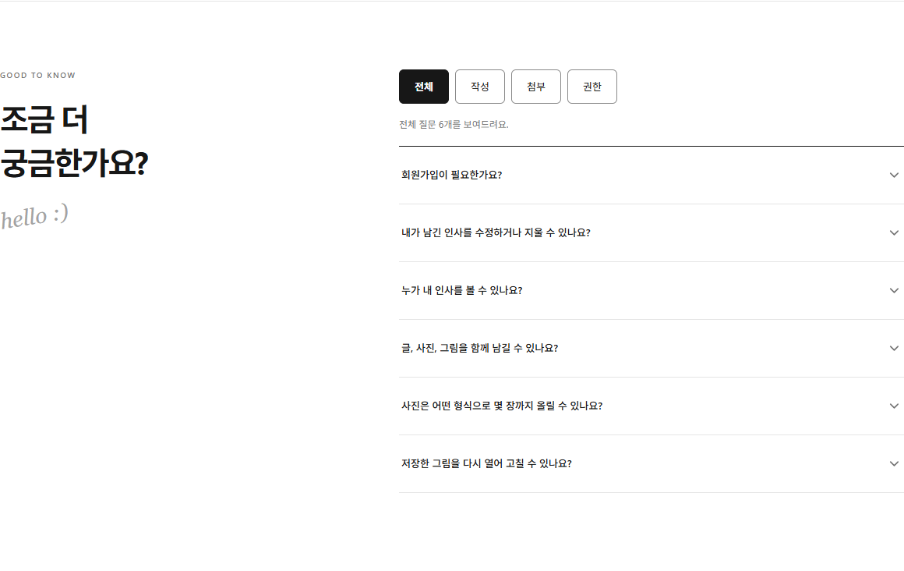
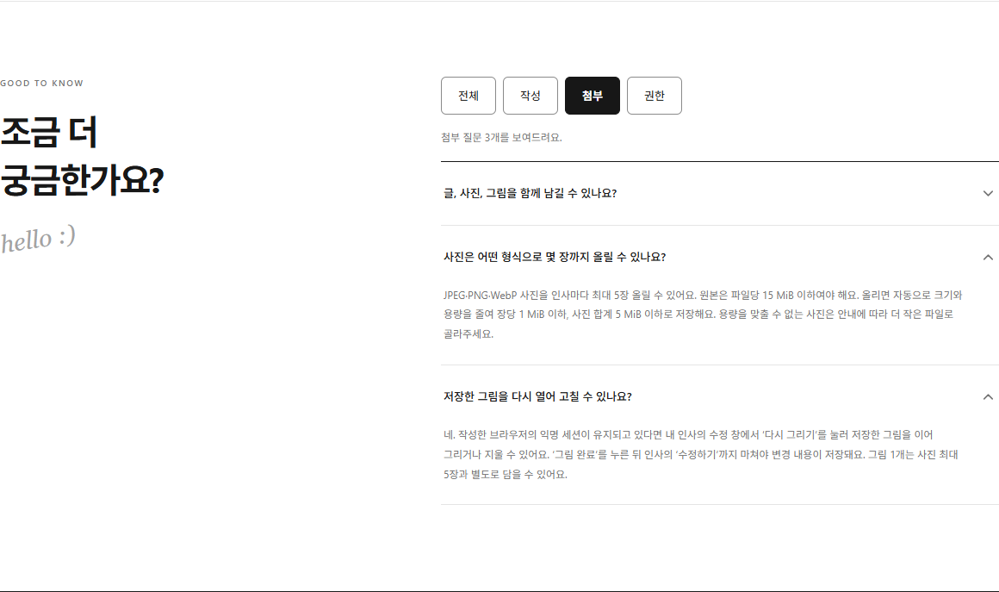
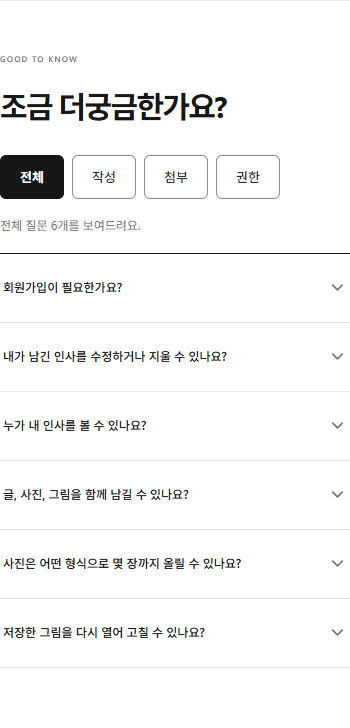

# FAQ 병렬 구현 결과 스크린샷

캡처일: 2026-10-15.
구현 기준: 통합 브랜치 demo/faq-parallel, 앱 소스는 `07faba8`과 동일하다.
실제 Chrome의 로컬 샘플 화면에서 FAQ 섹션을 캡처했다.
캡처 중 브라우저 런타임 오류·백엔드 요청·가로 넘침은 없었다.

## 데스크톱 전체 FAQ

뷰포트 1440×1000px. 전체 6개 질문과 네 개의 필터 버튼을 표시한다.

## 첨부 카테고리와 보강 답변

뷰포트 1440×1000px. 첨부 질문 3개 중 추가된 사진·그림 답변을 펼쳤다.

## 모바일 전체 FAQ

뷰포트 390×844px. 화면 양쪽 여백을 제외한 FAQ 섹션을 캡처했다.
필터 버튼과 질문 6개의 글자 잘림·겹침·가로 넘침이 보이지 않았다.

실기기·화면 읽기 프로그램 검증은 포함하지 않는다.
작업 과정은 [두 워크트리 예제](../../faq-worktree-example.md)를 참고한다.
