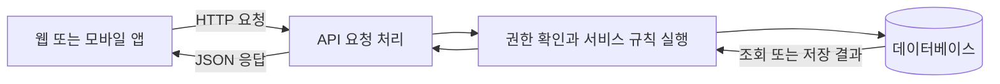

# 백엔드 기초 — 문제와 해결로 이해하기

참고 강의: 양실장의 바이브코딩대학, [비개발자 바이브코더가 가장 두려워하는 단어 '백엔드' 딱 이 내용만 알면 됩니다](https://www.youtube.com/watch?v=0SGfDKMLdaI&list=PL_2HfE1lhmxKSv9tSky-7L4sTyunZWiek)

기존 메모와 영상 전체의 한국어 자동 자막, 영상 설명의 목차를 바탕으로 재정리했다. 각 절의 시간 링크로 해당 구간을 다시 볼 수 있다. **보충**으로 표시한 내용은 강의의 비유나 간략한 설명을 더 정확하게 이해하기 위한 설명이다.

**백엔드는 사용자 요청을 받아 서비스 규칙을 실행하고, 데이터를 조회·저장한 뒤 결과를 돌려주는 부분이다.** 강의의 중심은 기술 이름을 외우는 것이 아니라, 각 기술이 어떤 문제를 해결하는지 이해하는 데 있다.

## 1. 정적 웹에서 동적 웹으로: 사용자마다 다른 결과가 필요하다

영상: [00:00 정적 웹과 입력의 한계](https://www.youtube.com/watch?v=0SGfDKMLdaI&t=0s) · [01:14 요청마다 HTML 생성](https://www.youtube.com/watch?v=0SGfDKMLdaI&t=74s)

초창기 웹에서 서버는 미리 만들어 둔 HTML 파일을 전달했다. 요청이 오면 파일을 꺼내 주는 **정적 웹**이다.

하지만 방명록에는 방문자가 방금 남긴 글이 보여야 한다. 검색 결과도 사용자가 입력한 검색어에 따라 달라진다. 이런 결과를 전부 미리 파일로 만들어 둘 수는 없다.

해결 방법은 **요청을 받을 때 서버에서 프로그램을 실행해 결과를 만드는 것**이다. 방명록 글을 저장하고, 지금까지 쌓인 글을 읽어 HTML을 만들어 응답한다. 이것이 **동적 웹**의 기본 흐름이다.

| 개념                       | 역할                                                                   |
| -------------------------- | ---------------------------------------------------------------------- |
| CGI                        | 웹 서버가 외부 프로그램을 실행해 요청을 처리하도록 연결하는 인터페이스 |
| PHP                        | 서버에서 실행되어 HTML 생성 등을 처리할 수 있는 프로그래밍 언어        |
| JSP                        | Java 기반으로 서버에서 동적 웹 페이지를 만드는 기술                    |
| SSR, Server-Side Rendering | 서버에서 HTML을 생성해 클라이언트에 전달하는 방식                      |
| CSR, Client-Side Rendering | 주로 브라우저에서 JavaScript로 화면을 구성하는 방식                    |

**보충:** CGI, PHP, JSP는 같은 종류의 도구가 아니다. 각각 인터페이스, 언어, 웹 페이지 기술이라는 차이가 있다. SSR과 CSR도 반드시 하나만 선택하는 것은 아니며 함께 사용할 수 있다.

## 2. 백엔드 언어가 달라도 기본 사고방식은 같다

영상: [02:42 프로그래밍의 공통 개념](https://www.youtube.com/watch?v=0SGfDKMLdaI&t=162s) · [03:40 클래스와 예외 처리](https://www.youtube.com/watch?v=0SGfDKMLdaI&t=220s)

언어마다 문법과 사용 방식은 다르지만, 요청을 처리하는 데 필요한 기본 개념은 겹친다.

| 개념            | 의미                                          | 로그인 기능에 적용하면                  |
| --------------- | --------------------------------------------- | --------------------------------------- |
| 변수            | 값을 담고 이름을 붙인다                       | 입력한 이메일을 저장한다                |
| 조건문          | 조건에 따라 동작을 나눈다                     | 비밀번호가 맞으면 로그인시킨다          |
| 반복문          | 작업을 반복한다                               | 여러 데이터를 하나씩 처리한다           |
| 함수            | 특정 동작을 묶어 재사용한다                   | 비밀번호 확인 동작을 함수로 만든다      |
| 데이터 타입     | 값의 종류를 구분한다                          | 이메일은 문자열, 성공 여부는 불리언이다 |
| 클래스          | 관련 데이터와 동작을 하나의 구조로 묶는다     | 사용자와 관련된 정보·동작을 정리한다    |
| 예외 처리       | 예상하지 못한 오류에 대응한다                 | DB 연결 실패 시 오류 응답을 보낸다      |
| 모듈·라이브러리 | 코드를 나누거나 이미 만들어진 기능을 활용한다 | 검증된 비밀번호 처리 기능을 가져다 쓴다 |

로그인의 기본 흐름은 `사용자 찾기 → 비밀번호 검증 → 성공 또는 실패 응답`이다. 언어가 바뀌어도 이 흐름은 유지된다.

**보충:** 모듈은 코드를 나눈 단위이고, 라이브러리는 재사용할 수 있는 기능의 모음이다. 클래스는 코드를 정리하는 방법 중 하나이며, 모든 백엔드가 반드시 클래스를 중심으로 만들어지는 것은 아니다.

## 3. 데이터베이스: 기록을 오래 보관하고 원하는 것을 찾는다

영상: [05:13 데이터 저장 문제](https://www.youtube.com/watch?v=0SGfDKMLdaI&t=313s)

방명록을 만들려면 이름과 메시지를 어딘가에 보관해야 한다. 메모리에만 두면 서버가 종료될 때 사라질 수 있다. 텍스트 파일에 저장할 수도 있지만, 데이터가 많아지면 검색·수정·동시 접근을 직접 관리하기 어려워진다.

**데이터베이스(DB)** 는 데이터를 체계적으로 저장하고 조회·수정·삭제할 수 있게 해 준다. 강의에서는 관계형 데이터베이스의 예로 MySQL을 소개한다.

관계형 DB는 표 형태로 생각하면 이해하기 쉽다.

| id  | name   | message             |
| --- | ------ | ------------------- |
| 1   | 홍길동 | 처음 방문했습니다.  |
| 2   | 김영희 | 강의 잘 들었습니다. |

- **테이블(Table):** 방명록처럼 관련 데이터를 모아 놓은 표.
- **행(Row):** 방명록 글 한 건에 해당하는 데이터.
- **열(Column):** 이름, 메시지처럼 각 데이터의 항목.
- **스키마(Schema):** 어떤 테이블·열·타입·제약 조건이 있는지 정의한 구조.
- **쿼리(Query):** DB에 조회나 변경을 요청하는 명령. 관계형 DB에서는 주로 SQL을 사용한다.

예를 들어 “홍길동이 작성한 글을 조회해 줘”라는 요청을 쿼리로 표현한다.

**보충:** 관계형 DB는 백엔드나 MySQL과 함께 처음 생긴 개념이 아니다. 강의는 웹서비스에 DB가 왜 필요한지를 설명하는 흐름으로 이해하면 된다.

## 4. MVC와 비즈니스 로직: 코드의 역할을 나눈다

영상: [06:13 MVC 패턴](https://www.youtube.com/watch?v=0SGfDKMLdaI&t=373s) · [07:01 비즈니스 로직](https://www.youtube.com/watch?v=0SGfDKMLdaI&t=421s)

기능이 늘어나면 화면 생성, DB 접근, 요청 처리 코드가 한 파일에 뒤섞인다. 한 기능을 고치려다 다른 기능까지 영향을 주기 쉬워진다.

**MVC**는 코드를 역할에 따라 나누는 설계 방식이다.

| 역할       | 하는 일                                     | 방명록 예시                                |
| ---------- | ------------------------------------------- | ------------------------------------------ |
| Model      | 데이터와 관련 규칙을 다룬다                 | 글을 조회하고 저장한다                     |
| View       | 사용자에게 보여줄 화면을 표현한다           | 방명록 목록 HTML을 만든다                  |
| Controller | 요청을 받아 필요한 처리를 연결하고 응답한다 | 글 등록 요청을 받아 처리 흐름으로 연결한다 |

**비즈니스 로직(Business Logic)** 은 서비스가 지켜야 할 규칙과 처리 절차다. 방명록이라면 “빈 글은 등록할 수 없다”, “작성자만 수정할 수 있다” 등이 해당한다.

쇼핑몰에서는 재고 확인, 결제 처리, 재고 차감, 배송 정보 등록 같은 과정이 비즈니스 로직이다.

**보충:** Model을 단순 DB 접근 코드로만 생각하면 범위가 너무 좁다. 비즈니스 로직을 별도의 서비스 계층에 두기도 한다. API 서버는 HTML View 대신 JSON을 응답할 수도 있다.

## 5. API: 화면과 데이터를 분리해서 주고받는다

영상: [07:53 모바일 시대](https://www.youtube.com/watch?v=0SGfDKMLdaI&t=473s) · [08:30 API와 데이터 중심 구조](https://www.youtube.com/watch?v=0SGfDKMLdaI&t=510s)

웹사이트와 모바일 앱이 같은 서비스를 이용하게 되면, 각 화면에 필요한 데이터를 공통으로 제공할 방법이 필요하다.

서버가 완성된 HTML을 보내는 대신 데이터를 보내면, 웹과 앱이 각자 화면을 만들 수 있다. 여기서 **API(Application Programming Interface)** 가 통신 창구 역할을 한다.

- **API:** 다른 프로그램이 정해진 방법으로 기능이나 데이터를 사용할 수 있게 하는 인터페이스.
- **엔드포인트(Endpoint):** 특정 요청을 받는 접점. HTTP API에서는 주소와 메서드를 함께 보면 동작을 알 수 있다.
- **JSON:** 데이터를 교환할 때 자주 사용하는 텍스트 형식. 객체, 배열, 문자열, 숫자 등을 표현한다.
- **REST:** 자원을 중심으로 일관된 인터페이스를 사용하는 등의 제약을 가진 아키텍처 스타일.

### 방명록 API 예시

아래 주소와 응답은 개념 이해를 위한 예시다.

| CRUD   | 의미 | HTTP 요청 예시                       |
| ------ | ---- | ------------------------------------ |
| Create | 생성 | `POST /guestbook`                    |
| Read   | 조회 | `GET /guestbook`, `GET /guestbook/1` |
| Update | 수정 | `PATCH /guestbook/1`                 |
| Delete | 삭제 | `DELETE /guestbook/1`                |

강의에서는 목록 조회를 강조하기 위해 CRUD에 List를 더한 **CRUDL**도 소개한다. 일반적인 CRUD에서는 단건 조회와 목록 조회를 모두 Read에 포함한다.

`GET /guestbook/1`의 JSON 응답 예시:

```json
{
  "id": 1,
  "name": "홍길동",
  "message": "처음 방문했습니다."
}
```

프론트엔드는 이 데이터로 화면을 구성하고, 백엔드는 데이터 처리와 서비스 규칙을 담당한다. API 요청 한 번의 흐름을 단순화하면 다음과 같다.



**보충:** API가 반드시 JSON을 쓰는 것은 아니며, JSON을 반환한다고 모두 REST인 것도 아니다. REST는 아이폰 출시 이전인 2000년 Roy Fielding의 논문에서 정리됐다. 모바일 확산은 데이터 API의 필요성을 이해하기 위한 배경이다. [REST 원문](https://ics.uci.edu/~fielding/pubs/dissertation/rest_arch_style.htm), [논문 표지와 연도](https://ics.uci.edu/~fielding/pubs/dissertation/top.htm)

## 6. 언어·실행 환경·프레임워크를 구분한다

영상: [10:34 백엔드 언어와 프레임워크](https://www.youtube.com/watch?v=0SGfDKMLdaI&t=634s)

**언어**는 코드를 작성하는 문법과 체계, **실행 환경(Runtime)** 은 코드를 실행하는 기반, **프레임워크**는 서버를 만들 때 필요한 구조와 기능을 제공하는 틀이다.

| 언어       | 강의에 나온 프레임워크·실행 환경           | 이해할 점                                                                 |
| ---------- | ------------------------------------------ | ------------------------------------------------------------------------- |
| PHP        | Laravel                                    | PHP로 웹 애플리케이션을 구조적으로 만들도록 돕는다                        |
| Python     | Django, FastAPI                            | Django는 웹 개발에 필요한 다양한 기능, FastAPI는 API 개발을 중심으로 한다 |
| Ruby       | Ruby on Rails                              | 정해진 관례를 활용해 개발하는 방식을 강조한다                             |
| Java       | Spring                                     | 규모가 큰 기업 시스템 등을 만드는 데 활용된다                             |
| C#         | ASP.NET                                    | .NET 기반으로 웹서비스를 만드는 기술이다                                  |
| Go         | 강의에서는 특정 프레임워크를 소개하지 않음 | 동시성 처리를 지원하는 언어다                                             |
| JavaScript | Node.js, NestJS                            | Node.js에서 서버 코드를 실행하고 NestJS로 구조를 잡을 수 있다             |

**보충:** Node.js는 언어나 프레임워크가 아니라 **JavaScript 실행 환경**이다. “JavaScript로 작성 → Node.js에서 실행 → NestJS의 틀로 서버 구성”으로 구분하면 된다. [Node.js 공식 소개](https://nodejs.org/en/about)

이 조합들은 모두 HTTP 요청을 받아 처리하고 응답하는 서버를 만드는 데 사용할 수 있다. 선택은 팀의 경험, 기존 시스템, 필요한 기능과 성능에 따라 달라진다.

## 7. 세션과 쿠키: 여러 요청 사이에 로그인을 유지한다

영상: [13:55 HTTP의 Stateless](https://www.youtube.com/watch?v=0SGfDKMLdaI&t=835s) · [14:41 세션과 쿠키](https://www.youtube.com/watch?v=0SGfDKMLdaI&t=881s)

HTTP는 기본적으로 **무상태(Stateless)** 다. 로그인 요청이 성공했다고 해서 다음 요청이 자동으로 같은 사용자의 요청임을 증명하지는 않는다.

세션 방식에서는 서버에 로그인 상태를 저장하고, 브라우저가 그 상태를 찾을 수 있는 식별자를 다시 보내도록 한다.

| 개념          | 역할                                                                      |
| ------------- | ------------------------------------------------------------------------- |
| 세션(Session) | 로그인한 사용자 등 요청 사이에 유지할 상태를 서버 측에서 관리한다         |
| 세션 ID       | 서버가 저장한 세션을 찾기 위한 식별자, 즉 번호표다                        |
| 쿠키(Cookie)  | 브라우저가 작은 데이터를 저장하고 조건에 맞는 요청에 함께 보내는 기능이다 |

일반적인 로그인 흐름:

1. 사용자가 아이디와 비밀번호를 보낸다.
2. 서버가 검증에 성공하면 세션을 만들고 세션 ID를 발급한다.
3. 서버의 `Set-Cookie` 응답으로 브라우저에 세션 ID를 저장한다.
4. 브라우저는 해당 사이트에 다음 요청을 보낼 때 쿠키를 함께 보낸다.
5. 서버는 세션 ID로 저장된 로그인 상태를 확인한다.

**보충:** “서버는 기억력이 없다”는 비유다. 서버가 상태를 저장할 수 없다는 뜻은 아니다. 애플리케이션이 세션을 사용해도 HTTP 자체는 무상태 프로토콜이다. 세션은 서버 메모리뿐 아니라 Redis나 DB 같은 공용 저장소에 둘 수도 있다. 쿠키도 로그인 외의 용도로 사용한다. [MDN 쿠키 설명](https://developer.mozilla.org/en-US/docs/Web/HTTP/Guides/Cookies)

## 8. 인증·인가·JWT·해싱: 서로 다른 문제를 해결한다

영상: [15:53 JWT와 비밀번호 해싱](https://www.youtube.com/watch?v=0SGfDKMLdaI&t=953s)

### 인증과 인가

| 개념                 | 확인하는 것                              | 예시                                        |
| -------------------- | ---------------------------------------- | ------------------------------------------- |
| 인증(Authentication) | 이 사용자가 누구인지                     | 로그인 정보를 검증해 사용자를 확인한다      |
| 인가(Authorization)  | 이 사용자가 해당 작업을 할 권한이 있는지 | 방명록 작성자만 자신의 글을 삭제하도록 한다 |

로그인한 사용자라고 해서 모든 데이터에 접근할 수 있는 것은 아니다. 인증 후에도 요청한 작업의 권한을 확인해야 한다.

### JWT: 검증할 수 있는 정보를 담은 토큰

서버마다 메모리에 세션을 따로 저장하면, 다른 서버로 요청이 갔을 때 로그인 상태를 찾지 못할 수 있다. 이 문제에는 **공용 세션 저장소** 를 쓰는 방법도 있고, **JWT(JSON Web Token)** 를 활용하는 방법도 있다.

강의에서 소개하는 서명된 JWT는 `헤더.페이로드.서명`의 세 부분으로 구성된다.

| 구성 요소         | 담는 내용                                      |
| ----------------- | ---------------------------------------------- |
| Header, 헤더      | 토큰 유형과 서명 알고리즘 등의 정보            |
| Payload, 페이로드 | 사용자 ID, 만료 시각 같은 정보인 클레임(Claim) |
| Signature, 서명   | 내용의 위조·변조 여부를 검증하는 값            |

서버는 요청에 포함된 토큰의 서명과 만료 시각 등을 검증한다. 여러 서버가 적절한 검증 키를 가지고 있다면 같은 토큰을 확인할 수 있다.

**보충:** 일반적인 서명 JWT의 헤더와 페이로드는 **Base64url 인코딩**되어 있다. 인코딩은 내용을 숨기는 암호화가 아니므로 읽을 수 있다. 서명은 변조를 검증하는 역할을 한다. 암호화된 JWT도 별도로 존재하지만, 강의의 세 부분 토큰 설명과 구분해야 한다. [JWT 표준 RFC 7519](https://www.rfc-editor.org/rfc/rfc7519.html)

JWT를 쓴다고 로그아웃·토큰 탈취 문제가 자동으로 해결되지는 않는다. 만료와 필요 시 무효화 방법도 설계해야 한다. 또한 JWT와 쿠키는 양자택일이 아니다. **JWT는 토큰 형식이고, 쿠키는 저장·전송 수단**이므로 JWT를 쿠키에 담을 수도 있다.

### 해싱: 비밀번호 원문을 저장하지 않는다

비밀번호는 원문 대신 **비밀번호 전용 해시 알고리즘으로 만든 결과**를 저장한다. 로그인할 때는 입력한 비밀번호를 저장된 해시와 검증한다.

**보충:** 해싱은 복호화해서 원문을 되찾는 방식이 아니다. 비밀번호 저장에는 솔트(Salt)와 적절한 비용 설정을 갖춘 Argon2id 같은 알고리즘을 사용한다. 해시가 유출돼도 안전이 보장되는 것은 아니며, 약한 비밀번호는 추측 공격으로 알아낼 수 있다. [OWASP 비밀번호 저장 지침](https://cheatsheetseries.owasp.org/cheatsheets/Password_Storage_Cheat_Sheet.html)

## 9. 비동기 처리와 동시성: 기다리는 동안 다른 일을 한다

영상: [16:49 사용자 증가와 성능 문제](https://www.youtube.com/watch?v=0SGfDKMLdaI&t=1009s) · [17:29 비동기 처리](https://www.youtube.com/watch?v=0SGfDKMLdaI&t=1049s)

요청을 처리하다 보면 DB 응답이나 외부 API를 기다리는 시간이 생긴다. 그동안 다른 요청을 처리할 수 있으면 서버의 자원을 더 효율적으로 사용할 수 있다.

| 개념                   | 의미                                                      |
| ---------------------- | --------------------------------------------------------- |
| 비동기 처리            | 작업 완료를 기다리는 동안 다른 작업을 진행할 수 있게 한다 |
| 동시성(Concurrency)    | 여러 작업의 진행을 겹쳐 처리한다                          |
| 병렬성(Parallelism)    | 여러 작업을 실제로 같은 순간에 실행한다                   |
| 멀티스레드             | 여러 실행 흐름을 사용해 작업을 처리한다                   |
| 이벤트 루프            | 준비된 작업과 완료 이벤트를 반복해서 처리하는 실행 구조다 |
| 논블로킹(Non-blocking) | 작업이 완료될 때까지 해당 실행 흐름을 붙잡아 두지 않는다  |

강의의 비유로 보면 멀티스레드는 여러 직원이 일하는 방식, 이벤트 루프는 한 직원이 대기 중인 일들을 두고 준비된 일을 번갈아 처리하는 방식이다.

**보충:** 동시성과 병렬성은 다르다. 비동기라고 반드시 멀티스레드인 것도 아니고, 동기 방식이라고 서버 전체가 요청을 하나씩만 처리하는 것도 아니다. 멀티스레드와 이벤트 루프를 함께 사용하는 시스템도 있다. 비동기는 대기 시간 활용에 도움이 되지만 계산량 자체를 줄이지는 않는다.

## 10. 캐시·Redis·CDN: 같은 일을 반복하지 않는다

영상: [18:09 캐시](https://www.youtube.com/watch?v=0SGfDKMLdaI&t=1089s)

많은 사용자가 같은 데이터를 조회할 때마다 같은 DB 작업을 반복하면 비용이 커진다. **캐시(Cache)** 는 이전 결과를 저장해 두고 다시 사용하는 방식이다.

예를 들어 방명록 목록의 캐시가 있으면 캐시에서 응답하고, 없으면 DB에서 조회한 뒤 결과를 캐시에 저장한다.

| 개념                          | 역할                                                             |
| ----------------------------- | ---------------------------------------------------------------- |
| Redis                         | 메모리 기반 데이터 저장소. 캐시나 공용 세션 저장소 등에 활용한다 |
| TTL, Time To Live             | 캐시 항목 등이 유효하게 남아 있는 시간                           |
| CDN, Content Delivery Network | 여러 지역의 서버를 활용해 이미지·동영상·정적 파일 등을 전달한다  |

캐시를 사용하면 DB 접근을 줄일 수 있고, CDN을 사용하면 사용자와 가까운 곳에서 파일을 전달할 수 있다.

**보충:** 캐시는 원본보다 오래된 데이터를 보여줄 수 있다. 방명록에 새 글을 등록했다면 기존 목록 캐시를 지우거나 갱신하는 방식이 필요하다. TTL을 정하는 것만으로 언제나 최신 데이터가 보장되지는 않는다. DB 성능도 디스크 속도뿐 아니라 쿼리·인덱스·연결 수 등에 영향을 받는다.

## 11. 트랜잭션과 ACID: 함께 처리해야 하는 변경을 묶는다

영상: [19:30 Commit과 Rollback](https://www.youtube.com/watch?v=0SGfDKMLdaI&t=1170s) · [20:39 ACID](https://www.youtube.com/watch?v=0SGfDKMLdaI&t=1239s)

계좌 이체에는 “A 계좌에서 10만 원 차감”과 “B 계좌에 10만 원 추가”가 함께 성공해야 한다. 한쪽만 성공하면 데이터가 잘못된 상태가 된다.

**트랜잭션(Transaction)** 은 여러 작업을 하나의 처리 단위로 묶는다.

```text
트랜잭션 시작
  → A 계좌에서 10만 원 차감
  → B 계좌에 10만 원 추가
  → 모두 성공하면 COMMIT: 변경 확정
  → 오류로 완료할 수 없으면 ROLLBACK: 변경 취소
```

| ACID        | 뜻     | 이해할 점                                                        |
| ----------- | ------ | ---------------------------------------------------------------- |
| Atomicity   | 원자성 | 묶인 변경이 모두 반영되거나 모두 취소된다                        |
| Consistency | 일관성 | 정의된 제약과 데이터 규칙을 만족하는 상태를 유지한다             |
| Isolation   | 격리성 | 동시에 실행되는 트랜잭션 사이의 영향을 격리 수준에 따라 제어한다 |
| Durability  | 지속성 | 성공적으로 확정된 변경은 장애가 발생해도 보존되어야 한다         |

**보충:** “커밋 전에는 DB에 아무것도 반영되지 않는다”는 설명은 변경이 아직 확정되지 않았다는 의미로 이해해야 한다. 트랜잭션 안에서는 자신의 변경을 볼 수 있고, 다른 트랜잭션에서의 가시성은 격리 수준에 따라 달라진다. DB 트랜잭션이 외부 결제나 이메일 발송까지 자동으로 되돌려 주는 것은 아니다. [PostgreSQL 트랜잭션 설명](https://www.postgresql.org/docs/current/tutorial-transactions.html)

## 12. 서버 확장과 로드 밸런서: 처리 용량을 늘린다

영상: [21:22 수직·수평 확장](https://www.youtube.com/watch?v=0SGfDKMLdaI&t=1282s) · [21:48 로드 밸런서](https://www.youtube.com/watch?v=0SGfDKMLdaI&t=1308s)

최적화만으로 처리할 수 없는 요청량이 들어오면 서버의 용량을 늘려야 한다.

| 방식                 | 의미                        | 예시                                      |
| -------------------- | --------------------------- | ----------------------------------------- |
| 수직 확장, Scale Up  | 서버 한 대의 성능을 높인다  | CPU·메모리를 늘린다                       |
| 수평 확장, Scale Out | 처리하는 서버의 수를 늘린다 | 같은 애플리케이션 서버를 여러 대 운영한다 |

**로드 밸런서(Load Balancer)** 는 들어온 요청을 여러 서버에 분배한다. 여러 서버가 협력해 처리하는 구조는 **분산 시스템(Distributed System)** 의 한 형태다.

**보충:** 서버 수를 늘리는 것만으로 문제가 모두 해결되지는 않는다. 공용 세션 저장소, 공유 데이터, DB의 처리 한계도 고려해야 한다. 수직·수평 확장은 함께 활용할 수도 있다.

## 13. 마이크로서비스·API Gateway·메시지 큐: 서비스를 나눠 운영한다

영상: [22:24 마이크로서비스](https://www.youtube.com/watch?v=0SGfDKMLdaI&t=1344s) · [22:52 API Gateway](https://www.youtube.com/watch?v=0SGfDKMLdaI&t=1372s) · [23:05 메시지 큐](https://www.youtube.com/watch?v=0SGfDKMLdaI&t=1385s)

### 모놀리스와 마이크로서비스

| 구조                | 의미                                                            | 특징                                                 |
| ------------------- | --------------------------------------------------------------- | ---------------------------------------------------- |
| 모놀리스(Monolith)  | 여러 기능을 하나의 애플리케이션·배포 단위로 구성한다            | 시작하기 쉽지만 기능 간 변경 영향이 커질 수 있다     |
| 마이크로서비스(MSA) | 기능이나 업무 경계를 기준으로 서비스를 나눠 독립적으로 운영한다 | 개별 배포·확장이 가능하지만 통신과 운영이 복잡해진다 |

쇼핑몰이라면 사용자, 상품, 주문, 결제를 각각의 서비스로 나눌 수 있다.

**보충:** 모놀리스도 여러 서버에 복제해서 운영할 수 있다. “모놀리스 = 서버 한 대”, “마이크로서비스 = 서버 여러 대”는 아니다. 마이크로서비스에서도 의존 관계에 따라 장애가 전파될 수 있으며, 서비스 사이의 데이터 일관성을 맞추기도 어려워진다. 항상 마이크로서비스가 더 나은 선택인 것은 아니다.

### API Gateway

API Gateway는 클라이언트 요청의 진입점으로, 요청을 적절한 서비스로 연결한다. 인증이나 요청량 제한 같은 공통 처리를 맡기도 한다.

예: `/users` 요청은 사용자 서비스로, `/orders` 요청은 주문 서비스로 연결한다.

로드 밸런서의 중심 역할은 **여러 서버로 요청을 분배하는 것**, API Gateway의 중심 역할은 **API 요청의 경로와 공통 정책을 관리하는 것**이다. 제품이나 구성에 따라 기능이 겹칠 수 있다.

### 메시지 큐(Message Queue)

서비스가 다른 서비스의 작업 완료를 즉시 기다리는 대신, 메시지를 큐에 넣어 두면 나중에 소비자가 처리할 수 있다.

```text
주문 서비스 → 큐에 주문 알림 메시지 저장 → 알림 서비스가 꺼내 처리
```

알림 서비스가 잠시 중단돼도 메시지가 보관되어 있다면 복구 후 처리할 수 있다. 갑자기 몰린 작업을 완충하는 데도 도움이 된다.

**보충:** 강의의 “주문이 사라지지 않는다”는 설명에는 메시지가 안전하게 보관된다는 전제가 있다. 실제로는 저장 방식, 처리 확인, 재시도 설정이 필요하다. 메시지가 중복 전달될 수 있으므로 같은 메시지를 다시 처리해도 결과가 중복되지 않도록 설계하기도 한다.

## 14. 배포·CI/CD·Docker·운영: 코드를 실제 서비스로 만든다

영상: [24:10 배포](https://www.youtube.com/watch?v=0SGfDKMLdaI&t=1450s) · [24:50 Docker](https://www.youtube.com/watch?v=0SGfDKMLdaI&t=1490s) · [25:05 개발·운영 환경](https://www.youtube.com/watch?v=0SGfDKMLdaI&t=1505s)

**배포(Deployment)** 는 만든 코드나 변경 사항을 실제 서비스 환경에 반영하는 과정이다.

서비스가 많아질수록 사람이 파일을 올리고 서버를 재시작하는 일을 반복하기 어렵다. 이를 일정한 절차로 자동화하는 것이 **CI/CD**다.

| 개념                       | 의미                                                                         |
| -------------------------- | ---------------------------------------------------------------------------- |
| CI, Continuous Integration | 변경 코드를 자주 통합하고 빌드·테스트 등을 자동으로 확인한다                 |
| Continuous Delivery        | 검증한 변경을 배포 가능한 상태로 준비한다. 운영 반영에는 승인이 있을 수 있다 |
| Continuous Deployment      | 검증을 통과한 변경을 운영 환경까지 자동으로 배포한다                         |

**보충:** CD는 Delivery 또는 Deployment를 뜻한다. 모든 CI/CD가 운영 환경에 자동 배포하는 것은 아니다.

### Docker: 실행 환경을 재현하기 쉽게 한다

내 컴퓨터와 서버의 라이브러리·실행 환경이 다르면 같은 코드도 다르게 동작할 수 있다. Docker는 애플리케이션과 실행에 필요한 구성 요소를 이미지로 묶고, 컨테이너로 실행한다.

- **이미지(Image):** 실행에 필요한 파일과 구성을 담은 템플릿.
- **컨테이너(Container):** 이미지를 바탕으로 실행되는 인스턴스.

**보충:** Docker가 모든 환경 차이를 없애는 것은 아니다. 외부 DB, 환경 변수, 저장소, 네트워크 설정도 맞아야 한다. 개발·운영에서 같은 이미지를 활용하면서 설정과 데이터를 분리할 수 있다. [Docker 공식 설명](https://docs.docker.com/get-started/docker-overview/)

### 환경 분리와 관찰

- **개발 환경:** 기능을 만들고 실험하는 곳.
- **운영 환경:** 실제 사용자에게 서비스를 제공하는 곳.
- **로그(Log):** 요청 처리나 오류 등 필요한 사건을 기록한 것.
- **모니터링(Monitoring):** 오류율·응답 시간·자원 사용량 등을 관찰하는 것.

개발·운영의 데이터와 접근 권한을 분리하고, 운영 중 문제를 찾아낼 기록과 지표를 마련해야 한다. 강의에서 말하는 **DevOps**는 개발과 운영을 연결해 배포와 서비스 관리를 개선하는 흐름이다.

## 15. 전체 흐름 복습

영상: [25:34 전체 흐름 정리](https://www.youtube.com/watch?v=0SGfDKMLdaI&t=1534s)

| 해결하려는 문제                            | 연결되는 기술·개념                            |
| ------------------------------------------ | --------------------------------------------- |
| 사용자마다 다른 화면이 필요하다            | 동적 웹, 서버 프로그램, SSR                   |
| 데이터를 보관하고 검색해야 한다            | 데이터베이스, 스키마, 쿼리                    |
| 코드가 뒤섞여 수정하기 어렵다              | MVC, 역할 분리, 비즈니스 로직                 |
| 웹과 앱에 공통 데이터를 제공해야 한다      | API, JSON, 프론트엔드·백엔드 역할 분리        |
| 요청 사이에 로그인 상태를 유지해야 한다    | 세션, 쿠키, 토큰                              |
| 사용자 신원과 접근 권한을 확인해야 한다    | 인증, 인가, JWT 검증, 비밀번호 해싱           |
| 대기 시간이 길고 같은 조회를 반복한다      | 비동기 처리, 동시성, 캐시, Redis, CDN         |
| 일부 변경만 성공하면 데이터가 꼬인다       | 트랜잭션, ACID, Commit, Rollback              |
| 서버 하나로 처리 용량이 부족하다           | 수직·수평 확장, 로드 밸런서                   |
| 기능별로 배포·확장을 나누고 싶다           | 마이크로서비스, API Gateway, 메시지 큐        |
| 변경을 안정적으로 사용자에게 전달해야 한다 | 배포, CI/CD, Docker, 환경 분리, 로그·모니터링 |

이 표는 **강의의 문제 해결 흐름**이다. 실제 기술의 최초 등장 연대표나 모든 서비스가 거쳐야 하는 필수 단계는 아니다. 특히 “2007년 REST 탄생”으로 외우면 안 된다. PHP도 1994년 개발이 시작됐고 1995년 처음 공개됐다. [PHP 공식 역사](https://www.php.net/manual/en/history.php.php)

### 이해했는지 확인하기

1. 방명록에는 왜 미리 만들어 둔 HTML만으로 부족할까?
2. 화면 코드, 데이터 접근, 서비스 규칙을 왜 나눌까?
3. API의 주소, HTTP 메서드, JSON 응답은 각각 무엇을 나타낼까?
4. 세션·세션 ID·쿠키는 어떤 관계일까?
5. 인증과 인가는 어떻게 다를까?
6. JWT의 인코딩과 서명은 각각 무엇을 할까?
7. 비동기 처리와 캐시는 서로 어떤 비용을 줄일까?
8. 트랜잭션, 서버 확장, 마이크로서비스는 각각 어떤 문제를 해결할까?
