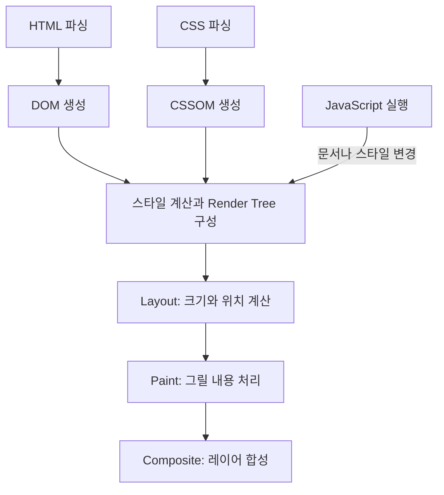

# 프론트엔드의 뿌리: 웹 문서에서 웹 애플리케이션까지

강의: [양실장의 바이브코딩대학 — 프론트엔드 기본 지식](https://youtu.be/Kl5EcYd3G2E?list=PL_2HfE1lhmxKSv9tSky-7L4sTyunZWiek)

> 기존 수강 메모와 영상 설명의 목차를 바탕으로 재정리했다. 개념 설명, 예제, 비교표는 보충 내용이며 공식 문서를 참고했다. 영상 자막 전문은 대조하지 못했다. 아래 시간은 영상 설명에 기재된 챕터 시작 시각이다.

## 1. 전체 흐름: 어떤 문제를 해결하려고 등장했을까?

프론트엔드의 흐름은 **문서를 전달하고 → 꾸미고 → 사용자 입력에 반응하고 → 복잡한 화면과 데이터를 관리하는 과정**으로 이해할 수 있다.

| 해결하려던 문제                     | 기술·개념               | 핵심 역할                                   |
| ----------------------------------- | ----------------------- | ------------------------------------------- |
| 다른 컴퓨터의 문서를 찾아 읽고 싶다 | 웹, HTML, URL, HTTP     | 문서의 구조·주소·전달 방식 마련             |
| 문서를 다양하게 꾸미고 싶다         | CSS                     | 내용의 구조와 시각적 표현 분리              |
| 클릭과 입력에 반응하고 싶다         | JavaScript, 이벤트, DOM | 화면을 프로그램으로 변경                    |
| 브라우저마다 동작이 다르다          | 웹 표준, jQuery         | 호환성 문제와 반복 작업 완화                |
| 화면과 데이터의 관계가 복잡해졌다   | React, 컴포넌트, 상태   | 상태에 맞는 UI를 구성하고 재사용            |
| 코드와 외부 도구가 많아졌다         | Node.js, npm, 빌드 도구 | 개발 도구 실행, 의존성 관리, 배포 파일 생성 |
| 페이지 이동을 앱처럼 만들고 싶다    | SPA, 클라이언트 라우팅  | 문서 전체를 다시 받지 않고 화면 전환        |
| 첫 화면과 검색 노출도 중요하다      | SSR, SSG, 혼합 렌더링   | 콘텐츠를 언제·어디서 만들지 선택            |

새 기술이 이전 기술을 없애는 것은 아니다. React와 Next.js를 사용해도 브라우저가 이해하는 HTML·CSS·JavaScript와 HTTP 통신이 바탕에 있다.

## 2. 인터넷과 웹은 어떻게 다를까? · 00:33

**인터넷(Internet)** 은 전 세계의 컴퓨터와 네트워크를 연결하는 인프라다. 그 위에서 웹, 이메일 등 여러 서비스가 동작한다.

**웹(Web, World Wide Web)** 은 문서와 자원을 주소로 식별하고, 링크로 연결하며, 브라우저를 통해 이용하는 시스템이다.

- 인터넷: 데이터를 주고받을 수 있는 연결 기반.
- 웹: 그 기반 위에서 문서와 서비스를 제공하는 방식.
- 하이퍼링크: 다른 문서나 자원으로 이동할 수 있게 만드는 연결.

팀 버너스리가 1989년 CERN에서 웹을 제안했고, 1990년 브라우저와 서버의 초기 구현이 만들어졌다. 1991년에는 웹이 더 넓게 공개되기 시작했다. [CERN의 웹 프로젝트 연혁](https://info.cern.ch/hypertext/WWW/History.html)

## 3. 웹의 세 가지 기본 요소: HTML·URL·HTTP · 01:47

| 요소 | 답하는 질문               | 역할                                         |
| ---- | ------------------------- | -------------------------------------------- |
| HTML | 어떤 내용과 구조인가?     | 문서의 제목, 문단, 링크, 입력 요소 등을 표현 |
| URL  | 어디에 있는 자원인가?     | 문서, 이미지, API 등의 위치를 나타내는 주소  |
| HTTP | 어떤 방식으로 주고받는가? | 클라이언트와 서버 사이의 요청·응답 규칙      |

예를 들어 `https://example.com/articles/1`에 접속하면 다음과 같은 일이 일어난다.

1. 브라우저가 URL에서 서버와 요청할 경로를 파악한다.
2. 서버에 HTTP 요청을 보낸다. `https`는 HTTP 통신을 TLS로 보호한다.
3. 서버가 상태 코드, 헤더, 본문을 포함한 응답을 보낸다.
4. 브라우저가 HTML을 읽고, 필요한 CSS·JavaScript·이미지 등을 추가로 요청한다.
5. 받은 자료를 처리해 화면을 표시한다.

실제로는 DNS 조회와 연결 설정 같은 과정도 포함된다. 위 순서는 웹의 요청·응답 관계를 이해하기 위한 단순화다.

**웹페이지(Web page)** 는 브라우저로 보는 하나의 문서다. 초기 웹은 문서를 읽고 링크를 따라 이동하는 용도가 중심이었다. 현대의 웹페이지에는 복잡한 상호작용도 포함된다.

**보충: 정적 페이지와 동적 페이지**

- 정적 제공: 미리 만들어 둔 파일을 전달한다.
- 동적 생성: 요청이나 데이터에 따라 서버가 응답 내용을 만든다.
- 브라우저에서 JavaScript로 화면을 바꾸는 것도 별개의 동적 동작이다.

따라서 정적으로 제공한 HTML 파일에도 클릭 이벤트를 넣을 수 있다. “정적 제공”과 “아무 동작도 없음”은 구분해야 한다.

## 4. HTML·CSS·JavaScript의 역할 · 03:52 / 05:31

| 기술       | 담당 영역                | 버튼을 예로 들면                |
| ---------- | ------------------------ | ------------------------------- |
| HTML       | 내용의 의미와 구조       | 버튼이라는 요소를 만든다        |
| CSS        | 색상, 배치, 크기 등 표현 | 버튼의 모양과 위치를 정한다     |
| JavaScript | 로직과 상호작용          | 버튼을 눌렀을 때 할 일을 정한다 |

### HTML: 내용의 의미와 구조

HTML은 마크업 언어다. `<h1>`은 제목, `<p>`는 문단, `<button>`은 버튼이라는 의미를 표현한다.

적절한 요소를 쓰면 브라우저의 기본 동작과 접근성 기능도 활용할 수 있다. 예를 들어 실제 `<button>`은 키보드로 조작할 수 있는 기본 동작을 제공한다.

### CSS: 구조와 표현을 분리

HTML에 표현을 위한 태그나 속성을 많이 섞으면 내용을 수정할 때 디자인까지 함께 관리해야 한다. CSS는 스타일 규칙을 따로 관리하고 여러 요소에 재사용할 수 있게 한다.

CSS는 색칠뿐 아니라 레이아웃, 반응형 화면, 애니메이션도 담당한다. CSS의 `Cascading`은 여러 스타일 규칙이 겹칠 때 우선순위에 따라 적용되는 방식을 뜻한다.

**연도 보정:** CSS는 1994년에 제안됐고, CSS1은 1996년 12월 W3C 권고안이 됐다. 기존 메모의 `1995: CSS`는 제안과 표준화 시점을 나누어 기억하는 편이 정확하다. [W3C의 CSS 역사](https://www.w3.org/Style/CSS20/history.html)

### JavaScript: 이벤트를 받아 화면과 데이터를 변경

- 이벤트(Event): 클릭, 입력, 스크롤 등 발생한 일을 알리는 신호.
- DOM(Document Object Model): 브라우저가 문서를 트리 형태의 객체로 표현하고, 프로그램에서 읽거나 수정할 수 있도록 제공하는 인터페이스.
- 이벤트 처리: 이벤트가 발생했을 때 실행할 함수를 연결하는 것.

HTML 파일은 문서의 소스이고, DOM은 브라우저가 그것을 해석해 만든 객체 구조다. JavaScript로 DOM을 변경하면 처음 받은 HTML과 현재 화면의 구조가 달라질 수 있다.

아래는 세 기술의 역할을 보여 주는 보충 예제다. `counter.html` 같은 파일로 저장하고 브라우저에서 열어 볼 수 있다.

```html
<!doctype html>
<html lang="ko">
  <head>
    <meta charset="UTF-8" />
    <meta name="viewport" content="width=device-width, initial-scale=1" />
    <title>클릭 카운터</title>
    <style>
      .Counter__Button {
        padding: 12px 20px;
        color: white;
        background-color: royalblue;
        border: 0;
        border-radius: 8px;
      }
    </style>
  </head>
  <body>
    <button class="Counter__Button" id="counter-button" type="button">
      클릭 수: 0
    </button>

    <script>
      let count = 0;
      const button = document.querySelector("#counter-button");

      button.addEventListener("click", () => {
        count += 1;
        button.textContent = `클릭 수: ${count}`;
      });
    </script>
  </body>
</html>
```

여기서는 개발자가 숫자를 바꾸고 DOM의 글자도 직접 바꾼다. 뒤에서 볼 React는 이 둘의 관계를 상태 기반으로 선언하게 한다.

JavaScript는 브라우저 밖에서도 실행할 수 있는 언어다. DOM과 `document`는 JavaScript 언어 자체가 아니라 브라우저가 제공하는 API다. [MDN의 JavaScript 설명](https://developer.mozilla.org/en-US/docs/Web/JavaScript)

## 5. 브라우저 전쟁과 크로스 브라우저 문제 · 07:45

넷스케이프와 마이크로소프트가 경쟁하던 시기에는 브라우저마다 기능과 구현 방식이 달라 같은 코드가 다르게 동작하는 일이 많았다.

**크로스 브라우저(Cross-browser)** 는 여러 브라우저에서 의도한 기능과 화면이 동작하도록 만드는 것을 뜻한다.

웹 표준과 브라우저 구현이 발전하면서 차이가 줄었지만, 현재도 지원 기능과 버전 차이는 확인해야 한다. 화면 크기에 대응하는 **반응형 디자인**과 브라우저 차이에 대응하는 **호환성 처리**도 서로 다른 과제다. [W3C의 브라우저와 CSS 구현 역사](https://www.w3.org/Style/CSS20/history.html)

## 6. 브라우저는 코드를 어떻게 화면으로 만들까? · 10:12

다음은 핵심 과정을 단순화한 그림이다.



| 단계                    | 하는 일                                              |
| ----------------------- | ---------------------------------------------------- |
| Parsing                 | HTML과 CSS를 해석해 DOM과 CSSOM을 만든다             |
| 스타일 계산·Render Tree | 스타일을 적용하고 화면 배치에 필요한 구조를 구성한다 |
| Layout                  | 요소의 크기와 위치를 계산한다                        |
| Paint                   | 글자, 배경, 테두리 등 그릴 내용을 처리한다           |
| Composite               | 필요한 레이어를 합성해 최종 화면을 만든다            |

`display: none`인 요소는 DOM에는 있어도 Render Tree에는 포함되지 않는다. 반면 `visibility: hidden`은 보이지 않아도 배치 공간은 유지한다.

### Reflow와 Repaint

**Reflow**는 변경으로 인해 레이아웃을 다시 계산하는 것을 말한다. 너비, 높이, 글자 크기 등의 변화가 원인이 될 수 있다.

**Repaint**는 색상처럼 배치를 바꾸지 않는 표현이 달라져 다시 그리는 것이다. 레이아웃 변경은 뒤따르는 페인트도 필요하게 할 수 있다.

성능 문제는 특히 DOM을 수정한 직후 크기를 읽는 작업을 반복해, 브라우저에 레이아웃 계산을 계속 강제할 때 발생할 수 있다. 변경할 작업과 읽을 작업을 모아서 처리하는 방법이 도움이 된다.

모든 변경이 전체 과정을 다시 실행하는 것은 아니다. 어떤 단계가 필요한지는 변경 내용과 브라우저 구현에 따라 달라진다. [MDN의 렌더링 경로 설명](https://developer.mozilla.org/en-US/docs/Web/Performance/Guides/Critical_rendering_path)

## 7. jQuery에서 React로: DOM 조작에서 상태 기반 UI로 · 12:01 / 12:54

### jQuery가 해결한 문제

jQuery는 DOM 탐색·변경, 이벤트 처리, Ajax 통신 등을 간단한 API로 제공하는 JavaScript 라이브러리다. 브라우저마다 다른 구현을 처리하는 부담도 줄였다. [jQuery 공식 소개](https://jquery.com/)

화면이 복잡해지면 호환성 외에 또 다른 문제가 생긴다. 예를 들어 장바구니 상품 하나를 삭제하면 상품 목록, 수량, 총액, 구매 버튼의 활성 상태를 함께 맞춰야 한다.

이 관계를 여러 곳의 DOM 수정 코드로 관리하면 일부 화면만 갱신하거나 서로 다른 값을 표시하기 쉽다. 이런 복잡성은 **데이터와 화면을 일관되게 관리하는 방식의 문제**다.

### React의 핵심 관점

React는 UI를 만드는 라이브러리다. **현재 상태에서 어떤 화면이 나와야 하는지 선언**하면, 상태 변경에 따른 UI 갱신을 React가 처리한다.

- 컴포넌트(Component): 버튼, 상품 카드, 검색창처럼 UI를 구성하는 단위.
- Props: 부모 컴포넌트가 자식에게 전달하는 입력값.
- 상태(State): 입력값, 선택한 상품, 펼침 여부 등 컴포넌트가 기억해야 하는 데이터.
- 선언형 UI: DOM 수정 절차를 일일이 적기보다 상태별 UI의 모습을 표현하는 방식.

앞의 카운터를 React 컴포넌트로 표현하면 다음과 같다. 이 코드는 React 프로젝트에서 사용하는 JSX 예제다.

```jsx
import { useState } from "react";

export default function Counter() {
  const [count, setCount] = useState(0);

  return (
    <button type="button" onClick={() => setCount((previous) => previous + 1)}>
      클릭 수: {count}
    </button>
  );
}
```

이벤트가 발생하면 `setCount`로 상태를 갱신한다. React는 새 상태를 바탕으로 UI를 계산하고 필요한 DOM 변경을 반영한다. 개발자가 `textContent`를 직접 수정하지 않아도 된다. [React의 상태 설명](https://react.dev/learn/state-a-components-memory)

**보충: React의 렌더링과 브라우저 렌더링은 다르다.**

- React 렌더링: 컴포넌트를 호출해 다음 UI를 계산한다.
- React 커밋(Commit): 계산 결과에 필요한 변경을 DOM에 반영한다.
- 브라우저 렌더링: DOM과 스타일을 바탕으로 배치하고 그린다.

React 컴포넌트가 다시 렌더링됐다고 해서 화면 전체를 다시 그리는 것은 아니다. React를 쓴다는 이유만으로 성능이나 상태 설계가 자동으로 좋아지는 것도 아니다. [React의 Render and Commit](https://react.dev/learn/render-and-commit)

## 8. Node.js와 npm: 프론트엔드 개발 도구의 실행 기반 · 14:58

### Node.js

Node.js는 브라우저 밖에서 JavaScript를 실행하는 런타임, 즉 실행 환경이다. 파일 처리, 서버 프로그램, 개발 서버와 빌드 도구 등에 사용한다. [Node.js 공식 소개](https://nodejs.org/learn/getting-started/introduction-to-nodejs)

프론트엔드 프로젝트에서는 보통 다음 두 환경이 함께 등장한다.

| 환경                    | 주로 실행하는 것                         |
| ----------------------- | ---------------------------------------- |
| 개발자 컴퓨터의 Node.js | 개발 서버, 빌드 도구, 각종 개발 스크립트 |
| 사용자 브라우저         | 배포된 JavaScript와 화면의 상호작용 코드 |

개발에 Node.js를 쓴다고 배포한 사이트에 Node.js 서버가 항상 필요한 것은 아니다. 정적 파일을 제공하는 사이트도 있고, SSR 등을 위해 서버 런타임이 필요한 사이트도 있다.

### npm과 의존성

npm에는 패키지를 설치·관리하는 도구와 패키지를 공유하는 레지스트리가 있다. “프로그래밍 세계의 앱스토어”는 공유 역할을 이해하는 비유다.

**의존성(Dependency)** 은 내 프로젝트가 사용하는 외부 패키지다. 외부 패키지도 다른 패키지에 의존할 수 있어 npm이 그 관계와 설치를 관리한다.

| 항목                | 의미                                                           |
| ------------------- | -------------------------------------------------------------- |
| `package.json`      | 프로젝트 정보, 실행 명령, 필요한 패키지와 버전 범위 선언       |
| `dependencies`      | 애플리케이션 동작에 사용하는 패키지                            |
| `devDependencies`   | 빌드, 검사 등 개발 과정에서 사용하는 패키지                    |
| `package-lock.json` | 설치된 의존성 트리와 구체적 버전을 기록해 재현성을 높이는 파일 |
| `node_modules`      | 설치한 패키지들이 저장되는 디렉터리                            |

`devDependencies`에 들어 있다는 이유만으로 그 패키지의 코드가 브라우저에서 절대 실행되지 않는 것은 아니다. 어떤 코드가 최종 배포 파일에 포함되는지는 실제 import와 빌드 결과로 결정된다. [npm의 package.json 설명](https://docs.npmjs.com/cli/v11/configuring-npm/package-json/), [package-lock.json 설명](https://docs.npmjs.com/cli/v11/configuring-npm/package-lock-json/)

## 9. 빌드: 개발용 코드를 배포용 결과물로 바꾸기 · 17:01 / 18:02

프로젝트가 커지면 여러 파일, 외부 패키지, JSX, TypeScript 등을 함께 관리하게 된다. **빌드(Build)** 는 이를 실행 환경에 맞는 결과물로 변환하고 최적화하는 과정이다.

| 작업            | 하는 일                                           | 예시·주의점                                              |
| --------------- | ------------------------------------------------- | -------------------------------------------------------- |
| 트랜스파일링    | 소스를 다른 문법이나 형태로 변환                  | JSX를 JavaScript로 변환하거나 지원 대상에 맞게 문법 변환 |
| 번들링          | 의존 관계를 분석해 실행에 필요한 파일 묶음을 생성 | 결과물이 반드시 파일 하나일 필요는 없다                  |
| 트리 셰이킹     | 사용되지 않는 것으로 판단한 코드를 제거           | 모듈 구조와 부수 효과 때문에 제거가 제한될 수 있다       |
| 코드 분할       | 필요할 때 불러올 수 있도록 코드를 나눔            | 초기 화면에 불필요한 기능의 로딩을 뒤로 미룸             |
| 프로덕션 최적화 | 배포 파일의 크기와 실행 비용을 줄임               | 코드 압축, 파일명 해시, CSS 최적화 등                    |

- Babel: JavaScript 문법 변환에 사용하는 도구.
- webpack: 모듈 번들러.
- Vite: 개발 서버와 프로덕션 빌드 기능을 제공하는 도구. 기존 메모의 `바이트`는 `Vite`로 정정한다. 공식 문서의 발음은 “비트”에 가깝다.

Vite를 사용하는 프로젝트의 명령은 보통 다음처럼 구성된다. 실제 명령은 프로젝트의 `package.json`에 따라 달라진다.

```powershell
npm install
npm run dev
npm run build
npm run preview
```

각각 패키지 설치, 개발 서버 실행, 배포 결과물 생성, 빌드 결과의 로컬 미리보기에 해당한다. **빌드와 배포는 별개**다. 빌드에 성공한 뒤 결과물을 호스팅 환경에 올려야 사용자가 접속할 수 있다. [Vite 공식 가이드](https://vite.dev/guide/)

아주 단순한 HTML·CSS·JavaScript 사이트는 빌드 과정 없이도 제공할 수 있다. 빌드는 프로젝트의 도구와 요구 사항에 따라 도입한다.

## 10. MPA와 SPA: 페이지를 이동하는 방식 · 20:00 / 21:16

| 구분               | MPA: Multi-Page Application       | SPA: Single-Page Application                    |
| ------------------ | --------------------------------- | ----------------------------------------------- |
| 핵심               | 여러 문서 사이를 이동             | 하나의 문서를 유지하며 화면을 전환              |
| 일반적인 내부 이동 | 새 HTML 문서를 요청하고 탐색      | JavaScript와 라우터가 화면을 갱신               |
| 데이터·자원 요청   | 문서 이동과 별도의 요청 모두 가능 | 이동 중에도 API·코드·이미지 등을 요청할 수 있음 |
| URL                | 문서 주소로 이동                  | History API 등을 통해 URL 변경 가능             |
| 고려할 점          | 이동할 때 문서가 다시 로드됨      | 라우팅, 상태 유지, 초기 로딩 등을 설계해야 함   |

**SPA의 “Single Page”는 화면이 하나라는 뜻이 아니다.** 상품 목록, 상세, 장바구니 등 여러 화면과 URL을 가질 수 있다. 이동할 때 문서 전체를 다시 로드하는지에 차이가 있다.

또한 SPA가 서버와 통신하지 않는다는 뜻도 아니다. 서버에서 필요한 데이터를 받아 화면의 일부를 갱신할 수 있다.

## 11. API와 프론트엔드의 역할 확장 · 14:24 / 22:06 / 23:02

**API(Application Programming Interface)** 는 프로그램이 다른 기능이나 데이터에 접근하도록 정한 인터페이스다. 웹 서비스에서는 백엔드의 데이터를 HTTP로 요청하는 창구를 가리키는 경우가 많다.

예를 들어 `GET /api/products`로 상품 데이터를 요청하고, 응답받은 JSON으로 상품 목록 UI를 만들 수 있다. 다음은 데이터 중심 웹앱의 한 가지 흐름이다.

```text
사용자 동작
  → 프론트엔드가 API 요청
  → 백엔드가 필요한 로직과 데이터 처리
  → 응답 반환
  → 프론트엔드가 상태 갱신
  → 화면 반영
```

HTML을 내려주는 서버와 API로 데이터만 내려주는 서버는 한 서비스 안에서도 함께 쓰일 수 있다. API가 모두 백엔드의 HTTP 주소인 것도 아니다. 앞서 본 DOM도 브라우저가 제공하는 API다.

프론트엔드의 역할은 화면을 마크업하는 작업에서 다음 영역까지 넓어졌다. 실제 퍼블리셔와 개발자의 업무 범위는 조직에 따라 다르다.

| 영역          | 해야 하는 일의 예                                    |
| ------------- | ---------------------------------------------------- |
| UI 구조 설계  | 컴포넌트의 책임과 데이터 전달 방식 정하기            |
| 상태 관리     | 입력값, 선택 상태, 서버 데이터 등을 일관되게 유지    |
| API 통신      | 요청뿐 아니라 로딩·실패·빈 결과·재시도 처리          |
| 성능          | 초기 로딩, 큰 파일, 불필요한 계산과 화면 갱신 줄이기 |
| 사용성·접근성 | 모바일 화면, 키보드 조작, 읽기 쉬운 피드백 제공      |

API를 연결한 화면은 성공한 경우 외에도 **로딩 중 / 실패 / 데이터 없음 / 성공** 상태를 표현해야 사용자가 상황을 이해할 수 있다.

## 12. CSR·SSR·SSG: 콘텐츠를 어디서, 언제 만들까? · 24:05 / 25:29

**MPA/SPA는 문서 탐색 방식이고, CSR/SSR은 UI를 렌더링하는 위치에 관한 구분이다.** 같은 질문에 대한 선택지가 아니다.

| 방식                               | 콘텐츠를 만드는 위치·시점              | 장점과 비용                                                                        |
| ---------------------------------- | -------------------------------------- | ---------------------------------------------------------------------------------- |
| CSR: Client-Side Rendering         | 브라우저에서 JavaScript로 주요 UI 생성 | 풍부한 상호작용에 적합하지만 JS 실행과 데이터 요청이 첫 콘텐츠 표시를 늦출 수 있음 |
| SSR: Server-Side Rendering         | 서버가 요청 시점에 HTML 생성           | 콘텐츠를 HTML로 전달하지만 서버 처리 시간과 운영 비용을 고려해야 함                |
| SSG: Static Site Generation — 보충 | 빌드 시점에 HTML 미리 생성             | 캐시·정적 제공에 유리하지만 내용 갱신 방식을 따로 설계해야 함                      |

### CSR 중심 SPA에서 자주 생기는 문제

**초기 로딩:** JavaScript를 내려받고 해석·실행한 뒤 데이터를 요청하면, 실제 콘텐츠가 표시되기까지 시간이 길어질 수 있다. 코드 분할, 캐시, 요청 순서 개선 등으로 줄일 수 있다.

**SEO(Search Engine Optimization):** 초기 HTML에 주요 콘텐츠가 적으면 검색 도구가 JavaScript를 실행해야 내용을 파악할 수 있다. Google은 JavaScript를 처리하지만 렌더링 대기나 자원 접근 실패가 영향을 줄 수 있고, 모든 크롤러가 JavaScript를 실행하는 것은 아니다.

따라서 `SPA = 검색 불가능`이라고 단정할 수는 없다. 서버 렌더링이나 사전 생성 HTML은 콘텐츠 접근성을 높이는 방법이고, 제목·메타데이터·링크·상태 코드 등도 함께 관리해야 한다. [Google의 JavaScript SEO 가이드](https://developers.google.com/search/docs/crawling-indexing/javascript/javascript-seo-basics)

### 하이드레이션(Hydration)

React에서 하이드레이션은 **서버가 만든 기존 HTML을 바탕으로 브라우저의 React가 UI를 연결해 상호작용할 수 있게 하는 과정**이다.

```text
서버에서 HTML 생성
  → 브라우저가 HTML로 초기 화면 표시
  → JavaScript 로드·실행
  → React가 기존 HTML에 연결
  → React의 이벤트와 상태 기반 상호작용 가능
```

화면이 보이는 시점과 React 상호작용이 준비되는 시점은 다를 수 있다. 일반 링크 같은 HTML의 기본 동작은 하이드레이션 전에도 가능하다.

서버 HTML과 브라우저의 첫 렌더링 결과는 일치해야 한다. 예를 들어 양쪽에서 서로 다른 시각이나 난수를 곧바로 출력하면 하이드레이션 불일치가 발생할 수 있다. [React의 hydrateRoot 설명](https://react.dev/reference/react-dom/client/hydrateRoot)

모든 SSR 페이지가 React 하이드레이션을 필요로 하는 것은 아니다. JavaScript를 붙이지 않은 서버 HTML도 웹페이지로 사용할 수 있다.

## 13. Next.js와 혼합 렌더링: 요구 사항에 맞춰 조합하기 · 26:12 / 26:50

Next.js는 React 기반 프레임워크다. 서버에서 만들 콘텐츠, 미리 생성할 콘텐츠, 브라우저에서 처리할 상호작용을 함께 구성할 수 있다.

예를 들어 블로그 본문은 사전에 생성하거나 서버에서 렌더링하고, 검색 입력이나 좋아요 버튼은 브라우저에서 상호작용하도록 만들 수 있다. 처음 방문할 때 HTML을 제공하고, 이후 내부 이동은 문서를 유지하며 처리하는 조합도 가능하다.

**보충: Next.js App Router의 컴포넌트 구분**

- Server Component: 서버에서 실행하며 데이터 접근과 UI 구성을 담당할 수 있다. 해당 컴포넌트 코드 자체는 브라우저에 보내지 않는다.
- Client Component: 상태, 이벤트, 브라우저 API 등이 필요한 부분을 담당한다. 첫 방문의 HTML 사전 렌더링에도 참여할 수 있고, 브라우저에서 하이드레이션된다.

`"use client"`를 붙였다고 초기 HTML 생성에서 무조건 제외되는 것은 아니다. 또한 Server/Client Component 구분과 SSR/CSR 구분도 완전히 같은 개념은 아니다. [Next.js의 Server and Client Components](https://nextjs.org/docs/app/getting-started/server-and-client-components)

### 트레이드오프(Trade-off)

어떤 방식의 이점을 얻으면 다른 비용이나 제약을 받아들여야 할 수 있다. 요구 사항에 따라 선택한다.

| 요구 사항                             | 검토할 방식          | 함께 확인할 점                            |
| ------------------------------------- | -------------------- | ----------------------------------------- |
| 자주 바뀌지 않는 공개 글              | SSG 등 사전 생성     | 수정한 내용을 언제 다시 생성할지          |
| 요청마다 달라지는 공개 콘텐츠         | SSR과 캐시           | 서버 응답 시간, 비용, 데이터 최신성       |
| 입력·필터·드래그가 많은 화면          | 클라이언트 상호작용  | 초기 JS 크기, 상태 구조, 갱신 비용        |
| 공개 콘텐츠와 복잡한 조작을 함께 제공 | 서버·클라이언트 조합 | 경계에서 전달할 데이터, 하이드레이션 비용 |

위 표는 정답표가 아니라 선택 기준이다. SSR을 쓰더라도 서버 응답이 늦거나 브라우저에서 실행할 JavaScript가 크면 느릴 수 있다.

## 14. 주요 시점과 메모 보정

| 시점        | 주요 변화                              |
| ----------- | -------------------------------------- |
| 1989        | 팀 버너스리가 웹 제안                  |
| 1990~1991   | 초기 브라우저·서버 구현과 웹 공개 확대 |
| 1994 / 1996 | CSS 제안 / CSS1 W3C 권고안             |
| 2006        | jQuery 공개                            |
| 2010        | npm 등장                               |
| 2013        | React 공개                             |

CSS 시점은 [W3C 연혁](https://www.w3.org/Style/CSS20/history.html)을 기준으로 보정했다. 웹의 초기 구현과 공개 시점은 [CERN 연혁](https://info.cern.ch/hypertext/WWW/History.html)을 참고했고, jQuery 공개 시점은 [공식 회고](https://blog.jquery.com/2026/01/17/jquery-4-0-0/)로 확인했다. npm과 React 시점은 기존 메모를 유지했다.

특히 다음 여섯 가지를 구분해 기억한다.

1. **인터넷 / 웹:** 연결 인프라와 그 위의 서비스.
2. **HTML / DOM:** 문서 소스와 브라우저가 해석한 객체 구조.
3. **JavaScript / Node.js:** 언어와 그 언어를 실행하는 환경.
4. **React / Next.js:** UI 라이브러리와 그 기반의 프레임워크.
5. **MPA·SPA / SSR·CSR:** 문서 탐색 방식과 렌더링 위치.
6. **빌드 / 배포:** 실행할 결과물을 만드는 작업과 사용자에게 제공하는 작업.

## 15. 복습 질문과 작은 실습

다음 질문을 자신의 말로 설명할 수 있으면 용어 사이의 관계를 이해한 것이다.

1. 인터넷은 있지만 웹을 사용하지 않는 서비스에는 무엇이 있을까?
2. HTML·URL·HTTP는 각각 어떤 문제를 해결할까?
3. JavaScript로 DOM을 바꾸면 처음 받은 HTML 파일도 바뀌는 걸까?
4. React에서는 일반 변수 대신 왜 상태를 사용할까?
5. 프론트엔드 개발에 Node.js가 쓰이는 이유는 무엇일까?
6. 번들링, 트리 셰이킹, 코드 분할은 어떻게 다를까?
7. SPA에서도 여러 URL과 서버 요청을 사용할 수 있을까?
8. SSR로 만든 첫 화면을 가진 SPA가 가능할까?
9. 화면이 보이는데 버튼 반응이 늦는 현상을 하이드레이션과 연결해 설명할 수 있을까?
10. API 요청이 실패하거나 결과가 없을 때 화면은 무엇을 보여 줘야 할까?

**보충 실습:** 위 카운터 예제를 실행하고 개발자 도구에서 확인한다.

- Elements: 클릭 전후에 버튼의 DOM 텍스트가 바뀌는지 확인한다.
- Console: 버튼을 여러 번 누른 뒤 `document.querySelector("#counter-button").textContent`를 읽어 본다.
- HTML 원본: DOM의 현재 텍스트와 처음 파일에 작성한 텍스트를 비교한다.
- Network: 배포된 웹페이지에서 HTML·CSS·JavaScript 요청을 관찰한다. 예제처럼 CSS와 JS가 HTML 안에 있으면 별도 파일 요청이 생기지 않는다는 점도 확인한다.

기술 이름을 외우는 데서 끝내지 않고, **요청·응답 → 문서 해석 → 화면 표시 → 이벤트 → 데이터 변경 → 화면 갱신**을 한 흐름으로 설명해 본다.
