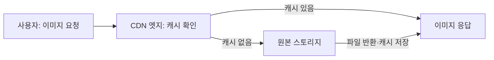
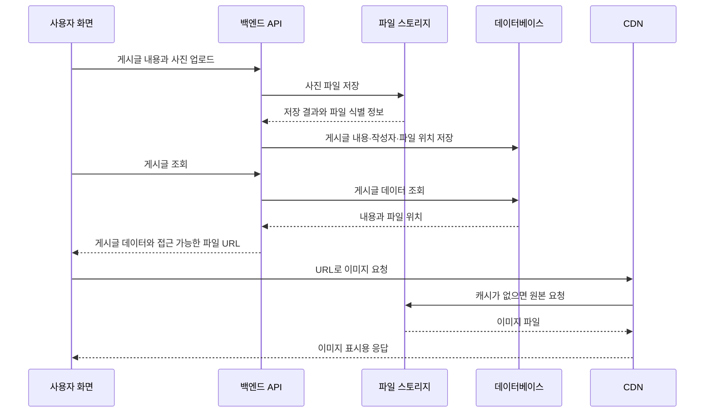

# 풀스택의 뿌리 — 데이터베이스와 스토리지

강의: 양실장의 바이브코딩대학, [여기까지 알면 비개발자 바이브코더도 풀스택 개발자 만큼 아는거에요 (DB와 스토리지)](https://youtu.be/yFuxjOHKips)

영상 전체의 한국어 자동 자막과 영상 설명의 챕터 목차를 바탕으로 정리했다. 시간 링크는 영상 설명의 챕터 시작 시각이다. 표·SQL·도식은 이해를 돕기 위해 만든 예시이며, **보충**으로 표시한 설명은 공식 문서로 확인한 내용이다. 제품 비교에 관한 보충 내용은 2026-10-06 기준이다.

**핵심은 데이터를 조회·관리하는 DB와 파일을 보관하는 스토리지의 역할을 구분하고, 이 둘이 인증과 함께 연결되는 구조를 이해하는 것이다.**

## 1. 강의 전체 흐름: 어떤 문제를 해결했을까?

영상: [00:00 DB와 스토리지를 함께 보는 이유](https://www.youtube.com/watch?v=yFuxjOHKips&t=0s)

| 출발점·문제 | 해결 방향 | 기억할 개념 |
| --- | --- | --- |
| 파일마다 데이터가 흩어져 관리하기 어렵다 | 데이터를 체계적으로 모으고 연결한다 | 데이터베이스 |
| 데이터 연결 경로를 직접 관리하기 복잡하다 | 표와 관계를 정의하고 원하는 결과를 요청한다 | 관계형 DB, SQL, JOIN |
| 중복 수정과 동시 작업에서 오류가 생긴다 | 설계와 처리 규칙으로 데이터의 무결성을 지킨다 | 정규화, 제약 조건, 트랜잭션 |
| 데이터와 요청이 대규모로 늘어난다 | 작업을 분산하고 용도에 맞는 저장 방식을 선택한다 | 수직·수평 확장, NoSQL |
| DB 설치·운영과 서비스 연결에 손이 많이 간다 | 운영을 맡기고 공통 백엔드 기능을 활용한다 | 관리형 DB, BaaS |
| 사용자 업로드 파일이 늘어난다 | 애플리케이션 서버와 파일 보관을 분리한다 | 클라우드·객체 스토리지 |
| 원본 파일이 사용자에게서 멀리 있다 | 가까운 서버에서 캐시를 전달한다 | CDN |
| 파일마다 공개 범위가 다르다 | 인증 결과와 접근 정책을 연결한다 | Public, Private, 서명된 URL, RLS |

강의는 이런 변화가 DB·인증·스토리지 등을 함께 제공하는 Supabase로 이어지는 과정을 설명한다. 이전 기술이 사라지는 과정이라기보다 **새로운 규모와 요구에 맞춰 선택지가 늘어난 과정**으로 보면 된다.

## 2. 파일로 데이터를 관리하면 생기는 네 가지 문제

영상: [00:56 파일로 관리하던 데이터](https://www.youtube.com/watch?v=yFuxjOHKips&t=56s) · [01:34 네 가지 문제](https://www.youtube.com/watch?v=yFuxjOHKips&t=94s)

고객·주문·재고 정보를 별도 파일에서 관리하는 상황을 떠올리면 이해하기 쉽다.

| 문제 | 예시 |
| --- | --- |
| 중복 데이터 | 고객의 연락처를 고객 파일과 여러 주문 파일에 반복해서 적는다 |
| 데이터 불일치 | 연락처를 한 파일에서만 고쳐 파일마다 다른 값이 남는다 |
| 검색의 비효율 | 특정 조건을 만족하는 주문을 찾으려고 많은 기록을 읽는다 |
| 동시 수정 충돌 | 두 사람이 같은 기록을 수정하면서 한쪽 변경을 덮어쓴다 |

DB를 쓰는 이유는 단순히 오래 보관하기 위해서만이 아니다. **데이터의 관계, 검색, 변경, 동시 접근을 관리할 수 있어야 하기 때문**이다.

**보충:** DB도 내부적으로 파일을 사용한다. 차이는 파일의 존재 여부보다 그 위에서 검색·제약 조건·트랜잭션 등을 관리하는 시스템에 있다. DB를 선택했다고 중복이나 오류가 자동으로 없어지는 것도 아니다. 적절한 설계가 필요하다.

## 3. 계층형·네트워크형 DB에서 관계형 DB로

영상: [02:42 계층형 DB](https://www.youtube.com/watch?v=yFuxjOHKips&t=162s) · [03:24 네트워크형 DB](https://www.youtube.com/watch?v=yFuxjOHKips&t=204s) · [03:55 관계형 DB](https://www.youtube.com/watch?v=yFuxjOHKips&t=235s)

강의에서 다루는 변화의 요점은 다음과 같다.

| 방식 | 데이터 연결 방식 | 강의에서 짚는 한계·변화 |
| --- | --- | --- |
| 계층형 DB | 나무처럼 부모·자식 관계로 연결 | 여러 방향으로 얽힌 관계를 표현하기 어렵다 |
| 네트워크형 DB | 여러 연결을 가진 그물 형태 | 연결과 접근 경로를 직접 다루는 부담이 크다 |
| 관계형 DB | 표에 저장하고 공통 값을 통해 연결 | 필요한 결과를 선언적으로 요청할 수 있다 |

관계형 모델은 데이터를 어떻게 찾아갈지보다 **어떤 데이터가 필요한지**를 표현하는 방향으로 이해하면 좋다.

## 4. 테이블·키·JOIN·SQL: 데이터를 나누고 다시 연결한다

영상: [04:22 테이블, JOIN, SQL](https://www.youtube.com/watch?v=yFuxjOHKips&t=262s)

관계형 DB에서 자주 만나는 용어부터 정리하자.

| 용어 | 뜻 |
| --- | --- |
| 테이블, Table | 고객·주문처럼 관련 기록을 모은 표 |
| 행, Row | 고객 한 명이나 주문 한 건에 해당하는 기록 |
| 열, Column | 이름·금액처럼 각 기록의 항목 |
| 기본 키, Primary Key | 행을 고유하게 식별하는 값 또는 값의 조합 |
| 외래 키, Foreign Key | 다른 테이블의 키 등을 참조하며 관계의 유효성을 검사하는 제약 조건 |
| 스키마, Schema | 이 문맥에서는 테이블·열·타입·제약 조건 등 데이터 구조의 정의 |
| SQL | 데이터를 조회·추가·수정·삭제하고 구조를 정의하는 언어 |
| JOIN | 조건에 맞는 여러 테이블의 행을 결합하는 연산 |

**보충 예시: 고객과 주문을 분리한 구조**

`customers` — 고객 테이블

| id | name | email |
| --- | --- | --- |
| 1 | 김하늘 | haneul@example.com |
| 2 | 이바다 | bada@example.com |

`orders` — 주문 테이블

| id | customer_id | product | amount |
| --- | --- | --- | --- |
| 101 | 1 | 키보드 | 50000 |
| 102 | 1 | 마우스 | 20000 |
| 103 | 2 | 모니터 | 250000 |

`orders.customer_id`로 주문한 고객을 연결한다. 여기에 외래 키를 정의하면 존재하지 않는 고객 ID를 넣는 일을 막을 수 있다. [PostgreSQL의 제약 조건](https://www.postgresql.org/docs/current/ddl-constraints.html)

다음 SQL은 고객 ID가 1인 사람의 이름과 주문 내역을 함께 조회한다.

```sql
SELECT c.name, o.product, o.amount
FROM customers AS c
JOIN orders AS o ON o.customer_id = c.id
WHERE c.id = 1;
```

- `SELECT`: 결과에 포함할 열.
- `FROM`: 조회를 시작할 테이블.
- `JOIN ... ON`: 어떤 조건으로 다른 테이블과 연결할지.
- `WHERE`: 결과를 제한하는 조건.

위 예시에서는 김하늘의 키보드·마우스 주문이 나온다. JOIN은 테이블을 영구적으로 합치는 것이 아니라 **조회 결과를 만드는 과정에서 행을 결합**한다. [PostgreSQL의 JOIN 설명](https://www.postgresql.org/docs/current/tutorial-join.html)

## 5. 정규화: 같은 사실을 여러 곳에서 고치지 않게 한다

영상: [05:07 정규화](https://www.youtube.com/watch?v=yFuxjOHKips&t=307s)

고객의 현재 연락처를 모든 주문 행에 복사하면, 연락처가 바뀔 때 주문 기록을 여러 개 수정해야 한다. 일부만 수정하면 값이 어긋난다.

**정규화(Normalization)** 는 데이터의 의존 관계를 고려해 테이블을 구성하고, 불필요한 중복과 갱신 이상을 줄이는 설계 과정이다. 예를 들어 고객의 현재 연락처는 고객 테이블에서 관리하고 주문에서는 고객 ID를 참조한다. [Microsoft의 정규화 설명](https://learn.microsoft.com/en-us/previous-versions/troubleshoot/microsoft-365/microsoft-365-apps/access/database-normalization-description)

**보충:** 모든 중복이 잘못된 것은 아니다. 주문 당시 배송지처럼 과거 상태를 보존해야 하는 정보는 별도로 저장할 수 있다. ‘현재 연락처’와 ‘주문 시점의 배송지’는 서로 다른 사실이다. 정규화는 무조건 표를 잘게 나누라는 규칙으로 외우기보다 **각 정보가 무엇에 속하고 언제의 상태를 나타내는지** 생각하는 데서 시작하면 된다.

## 6. 관계형 DB의 주요 도구: 트랜잭션·ACID·인덱스

영상: [05:46 Oracle, MySQL, PostgreSQL](https://www.youtube.com/watch?v=yFuxjOHKips&t=346s) · [06:47 ACID와 인덱스](https://www.youtube.com/watch?v=yFuxjOHKips&t=407s)

Oracle Database, MySQL, PostgreSQL은 관계형 DB를 구현한 대표적인 제품이다. **SQL은 언어이고, PostgreSQL은 그 언어로 데이터를 다룰 수 있는 DB 시스템**이라는 차이를 기억하자.

### 트랜잭션과 ACID

**보충:** 트랜잭션은 여러 DB 작업을 하나의 처리 단위로 묶는다. 예를 들어 주문을 저장하면서 재고를 줄일 때, 중간 실패로 주문만 생기거나 재고만 줄어드는 일을 막도록 구성한다.

| 원칙 | 뜻 | 주문 처리에 적용하면 |
| --- | --- | --- |
| Atomicity, 원자성 | 묶인 작업이 전부 반영되거나 전부 취소된다 | 주문 저장과 재고 변경을 함께 완료한다 |
| Consistency, 일관성 | 정의한 제약과 규칙을 지키는 상태를 유지한다 | 적절한 제약을 통해 유효하지 않은 값의 저장을 막는다 |
| Isolation, 격리성 | 동시 작업 사이의 간섭을 격리 수준에 따라 제어한다 | 여러 주문이 같은 재고를 처리할 때 충돌을 관리한다 |
| Durability, 지속성 | 완료된 변경을 영구적으로 보존한다 | 커밋한 주문이 장애 후에도 복구될 수 있게 한다 |

`COMMIT`은 변경을 확정하고 `ROLLBACK`은 취소한다. **트랜잭션의 범위와 격리 수준을 제대로 설계해야 한다.** 위 표는 개념 설명이며, 결제 서비스 같은 외부 시스템의 작업까지 DB 트랜잭션 하나로 되돌릴 수 있다는 뜻은 아니다. [PostgreSQL의 트랜잭션 설명](https://www.postgresql.org/docs/current/tutorial-transactions.html)

### 인덱스

인덱스(Index)는 조건에 맞는 데이터를 효율적으로 찾도록 돕는 별도 자료구조다. 책의 색인을 생각하면 쉽다.

**보충:** 인덱스에는 저장 공간과 유지 비용이 든다. 데이터를 추가·변경하면 관련 인덱스도 갱신해야 하므로 모든 열에 무조건 만드는 것은 좋은 방법이 아니다. DB는 인덱스가 있어도 전체를 읽는 편이 유리하다고 판단하면 사용하지 않을 수 있다. [PostgreSQL의 인덱스 설명](https://www.postgresql.org/docs/current/indexes-intro.html)

## 7. 규모가 커지면: 수직·수평 확장과 NoSQL

영상: [07:36 데이터 규모의 증가](https://www.youtube.com/watch?v=yFuxjOHKips&t=456s) · [08:46 NoSQL](https://www.youtube.com/watch?v=yFuxjOHKips&t=526s)

| 확장 방식 | 의미 | 생각해 볼 점 |
| --- | --- | --- |
| 수직 확장, Scale Up | 한 서버의 CPU·메모리 등 성능을 높인다 | 한 대의 성능과 비용에 한계가 있다 |
| 수평 확장, Scale Out | 여러 서버로 작업을 나눈다 | 데이터 분배와 서버 간 일관성 관리가 필요하다 |

강의는 대규모 서비스의 요구와 함께 NoSQL이 주목받는 흐름을 설명한다. NoSQL은 관계형 테이블 외의 데이터 모델을 사용하는 DB들을 폭넓게 가리킨다.

강의에서 소개하는 예시는 다음과 같다.

| 도구 | 중심 모델·용도 |
| --- | --- |
| MongoDB | 필드와 배열 등을 가진 문서 형태로 데이터를 저장 |
| Redis | 메모리를 활용한 빠른 데이터 접근, 캐시 등 |
| Cassandra | 여러 노드에 분산하는 대규모 데이터 처리 |

**보충 — ‘NoSQL = 정확성을 포기한 DB’로 외우면 안 된다.**

MongoDB도 ACID 트랜잭션을 지원한다. 보장 범위와 비용은 제품·설정·작업에 따라 다르다. [MongoDB의 트랜잭션 설명](https://www.mongodb.com/docs/manual/core/transactions/)

또한 ‘스키마가 유연하다’는 말은 설계가 필요 없다는 뜻이 아니다. MongoDB는 문서마다 필드가 달라도 저장할 수 있지만 스키마 검증을 적용할 수 있고, 관계를 내장하거나 참조하도록 설계해야 한다. [MongoDB의 데이터 모델링 설명](https://www.mongodb.com/docs/manual/data-modeling/)

관계형 DB도 읽기 복제본 등을 통해 작업을 분산할 수 있다. 따라서 ‘관계형은 한 대만 가능하다’거나 ‘SNS는 반드시 NoSQL을 쓴다’는 식의 구분은 지나치게 단순하다. 실제로는 **조회 형태, 관계의 복잡성, 필요한 보장, 운영 비용**을 함께 본다. [Amazon RDS의 확장·복제본 설명](https://docs.aws.amazon.com/AmazonRDS/latest/UserGuide/Welcome.html)

## 8. 관리형 DB에서 BaaS로: 설치보다 제품 개발에 집중한다

영상: [10:07 클라우드 DB와 서버리스](https://www.youtube.com/watch?v=yFuxjOHKips&t=607s) · [11:38 개발 속도](https://www.youtube.com/watch?v=yFuxjOHKips&t=698s) · [12:54 Supabase의 등장 배경](https://www.youtube.com/watch?v=yFuxjOHKips&t=774s)

| 개념 | 맡기는 범위 |
| --- | --- |
| 직접 운영하는 DB | 설치·업데이트·백업·장애 대응 등을 직접 관리 |
| 관리형 DB, Managed Database | 클라우드 업체가 많은 DB 운영 작업을 담당 |
| 서버리스, Serverless | 서버 프로비저닝·운영 등의 부담을 플랫폼이 추상화 |
| BaaS, Backend as a Service | DB 외에 인증·스토리지·API 등 공통 백엔드 기능도 제공 |

**보충:** 관리형 DB와 서버리스는 같은 말이 아니다. 예를 들어 RDS는 관리형 서비스지만 모든 구성 방식이 서버리스인 것은 아니다. 서버리스에서도 실제 서버는 존재한다.

RDS 같은 서비스는 백업·패치·장애 대응의 부담을 줄여 준다. 다만 데이터 모델, 쿼리 성능, 접근 권한 등은 여전히 개발자가 설계해야 한다. [Amazon RDS의 관리 책임 설명](https://docs.aws.amazon.com/AmazonRDS/latest/UserGuide/Welcome.html)

서비스를 만들 때는 DB 하나만 필요한 것도 아니다. 화면에서 접근할 API, 로그인, 파일 업로드, 변경 알림까지 연결해야 한다. BaaS는 이런 공통 기능을 함께 제공해 연결 작업을 줄여 준다. [Supabase의 제공 기능](https://supabase.com/docs)

## 9. 스토리지: 사용자 파일이 늘어나며 별도 역할이 필요해졌다

영상: [13:24 스토리지의 시작](https://www.youtube.com/watch?v=yFuxjOHKips&t=804s) · [14:03 이미지·영상의 증가](https://www.youtube.com/watch?v=yFuxjOHKips&t=843s) · [14:58 사용자 업로드](https://www.youtube.com/watch?v=yFuxjOHKips&t=898s)

스토리지(Storage)는 데이터를 보관하는 저장 공간·시스템이다. 이 강의에서는 주로 사진·영상·문서 같은 파일을 저장하는 서비스라는 의미로 사용한다.

개인 컴퓨터의 파일에서 웹사이트의 이미지로, 다시 수많은 사용자가 올리는 파일로 범위가 넓어지면서 파일 관리가 서비스 운영의 문제가 됐다.

**보충:** 이미지·영상의 바이너리 형식은 사람이 텍스트처럼 바로 읽기 어려운 형식이라는 뜻으로 이해하면 된다. 텍스트 역시 컴퓨터 안에서는 바이트로 저장된다.

### 애플리케이션 서버에 파일을 직접 저장할 때

영상: [15:28 서버의 업로드 폴더](https://www.youtube.com/watch?v=yFuxjOHKips&t=928s) · [16:08 세 가지 한계](https://www.youtube.com/watch?v=yFuxjOHKips&t=968s)

강의는 다음 세 가지 부담을 설명한다.

- 디스크 장애 시 파일을 잃을 수 있어 백업·복구를 준비해야 한다.
- 서버를 여러 대로 늘리면 파일이 어느 서버에 있는지와 공유 방법을 관리해야 한다.
- 파일 전송이 몰리면 애플리케이션 요청 처리와 자원을 경쟁한다.

이 부담을 줄이는 방향이 **파일 보관을 별도 스토리지로 분리하는 것**이다.

## 10. 객체 스토리지: 버킷·객체·키로 파일을 다룬다

영상: [16:47 클라우드 스토리지와 S3](https://www.youtube.com/watch?v=yFuxjOHKips&t=1007s) · [17:57 객체 스토리지](https://www.youtube.com/watch?v=yFuxjOHKips&t=1077s)

Amazon S3는 대표적인 객체 스토리지다. 파일 데이터를 객체로 저장하고 키로 식별한다.

| 용어 | 의미 | 예시 |
| --- | --- | --- |
| 버킷, Bucket | 객체를 담는 저장 단위 | `post-images` |
| 객체, Object | 파일 데이터와 관련 메타데이터를 포함한 저장 단위 | 사진 한 장 |
| 키, Key | 버킷 안에서 객체를 식별하는 이름 | `users/42/photo-101.jpg` |
| 메타데이터, Metadata | 객체에 관한 부가 정보 | 콘텐츠 타입 등 |

**보충:** 일반적인 S3 버킷의 객체 키에서 `/`는 이름의 일부다. 관리 화면이 접두사를 폴더처럼 보여 줄 수 있지만 일반 파일 시스템의 디렉터리와 동일하게 생각하면 안 된다. 객체를 식별하려면 버킷과 키를 함께 알아야 한다. [S3 객체 키와 접두사](https://docs.aws.amazon.com/AmazonS3/latest/userguide/object-keys.html)

파일에 URL이 있다는 것과 공개되어 있다는 것은 별개다. 실제 다운로드 가능 여부는 접근 설정에 달려 있다.

## 11. CDN: 파일 보관과 전달 속도는 다른 문제다

영상: [19:12 CDN](https://www.youtube.com/watch?v=yFuxjOHKips&t=1152s)

**CDN(Content Delivery Network)** 은 분산된 서버를 활용해 콘텐츠를 효율적으로 전달한다.

- **원본, Origin:** 파일을 가져오는 원본 저장소·서버.
- **엣지, Edge:** 사용자 요청을 받아 콘텐츠를 전달하는 분산 서버.
- **캐시, Cache:** 재사용하려고 보관해 둔 응답·파일 사본.
- **지연 시간, Latency:** 요청과 응답에 걸리는 시간.

**보충 — 모든 파일을 미리 모든 엣지에 복사하는 것은 아니다.** 일반적인 CDN에서는 요청한 파일이 캐시에 있으면 바로 반환하고, 없으면 원본 등에서 가져온 뒤 캐시한다. 엣지 선택도 단순한 지리적 거리만이 아니라 네트워크 지연 등을 고려한다. [CloudFront의 콘텐츠 전달 과정](https://docs.aws.amazon.com/AmazonCloudFront/latest/DeveloperGuide/HowCloudFrontWorks.html)



스토리지는 **어디에 보관할지**, CDN은 **어떻게 전달할지**를 담당한다. 같은 시스템에서 함께 쓰지만 역할은 구분해야 한다.

## 12. 파일 접근 권한: Public·Private·서명된 URL

영상: [20:43 파일 전달과 접근 권한](https://www.youtube.com/watch?v=yFuxjOHKips&t=1243s)

| 방식 | 접근 방법 | 예시 |
| --- | --- | --- |
| Public | 공개 URL로 파일을 읽는다 | 공개 게시글 이미지 |
| Private | 인증·정책 등으로 허용된 접근만 받는다 | 개인 문서 |
| 서명된 URL | 특정 작업을 허용하는 제한된 수명의 URL을 사용한다 | 일정 시간 유효한 다운로드 링크 |

**보충:** S3의 Presigned URL은 서명한 주체의 권한 범위에서 특정 객체에 대한 다운로드·업로드 등을 허용한다. 만료 시간을 정할 수 있으며 **URL을 가진 사람은 유효한 동안 사용할 수 있다.** 사용자 한 명에게 발급했다고 그 사람만 사용할 수 있는 링크가 자동으로 되는 것은 아니다. 발급 전에 서비스의 접근 권한을 확인해야 한다. [S3의 서명된 URL](https://docs.aws.amazon.com/AmazonS3/latest/userguide/using-presigned-url.html)

Supabase에서는 버킷을 Public 또는 Private으로 설정한다. Private 파일은 사용자 JWT와 RLS 정책으로 접근하거나 서명된 URL로 내려받을 수 있다. Public 버킷은 파일 읽기가 공개되지만 업로드·삭제 등 다른 작업의 접근 제어는 계속 적용된다. [Supabase 버킷의 접근 모델](https://supabase.com/docs/guides/storage/buckets/fundamentals)

인증은 **누구인지 확인하는 일**, 권한 부여는 **무엇을 할 수 있는지 결정하는 일**이다. 로그인했다고 모든 파일을 볼 수 있게 되는 것은 아니다.

## 13. 사진 게시글 예시: DB와 스토리지가 연결되는 흐름

영상: [22:52 DB에는 파일의 위치를 저장](https://www.youtube.com/watch?v=yFuxjOHKips&t=1372s)

다음은 강의의 업로드 흐름을 일반적인 사진 게시판 예시로 표현한 것이다. 특정 SNS의 실제 내부 구현을 설명하는 도식은 아니다.



| 보관할 내용 | 담당 위치 |
| --- | --- |
| 제목, 본문, 작성자 ID, 작성 시각 | DB |
| 이미지·영상·첨부파일의 실제 바이트 | 파일 스토리지 |
| 어떤 게시글에 어떤 파일이 연결되는지 | DB의 파일 위치·식별 정보 |
| 재사용할 파일 사본 | CDN 캐시 |

**보충 1 — DB에 파일을 넣는 것이 기술적으로 불가능한 것은 아니다.** PostgreSQL에도 `bytea` 같은 바이너리 타입이 있다. 강의의 요점은 보통 큰 파일을 객체 스토리지에 두고 관계·검색용 정보는 DB에서 관리한다는 설계 방향이다. [PostgreSQL의 바이너리 타입](https://www.postgresql.org/docs/current/datatype-binary.html)

**보충 2 — DB에는 영구 URL만 저장해야 하는 것도 아니다.** 특히 비공개 파일은 버킷·키 등 안정적인 식별 정보를 저장하고 필요할 때 접근 URL을 만드는 방식이 적합하다. 만료되는 서명 URL을 영구적인 파일 위치로 사용하면 나중에 접근이 실패할 수 있다. 이는 객체 키와 서명 URL의 성질을 위 예시에 적용한 설계 설명이다.

**보충 3 — 업로드가 항상 백엔드 서버를 경유해야 하는 것은 아니다.** 서버가 업로드 권한을 확인하고 서명된 업로드 URL을 발급하면, 화면에서 스토리지로 직접 전송할 수도 있다. [S3의 서명된 업로드·다운로드](https://docs.aws.amazon.com/AmazonS3/latest/userguide/using-presigned-url.html)

## 14. Supabase: DB·인증·스토리지·API·Realtime을 연결한다

영상: [24:57 Supabase의 기능](https://www.youtube.com/watch?v=yFuxjOHKips&t=1497s) · [25:12 주요 구성](https://www.youtube.com/watch?v=yFuxjOHKips&t=1512s) · [26:18 함께 묶이는 이유](https://www.youtube.com/watch?v=yFuxjOHKips&t=1578s)

Supabase는 PostgreSQL을 중심으로 공통 백엔드 기능을 제공하는 플랫폼이다.

| 기능 | 역할 | 사진 게시판에 적용하면 |
| --- | --- | --- |
| Database | PostgreSQL로 데이터와 관계를 관리 | 게시글·댓글 저장 |
| Auth | 이메일·소셜 로그인 등 사용자 인증 | 작성자 식별 |
| Storage | 파일 저장·전달과 접근 정책 | 게시글 이미지 저장 |
| 자동 생성 API | DB 구조에 기반한 데이터 접근 API | 게시글 추가·조회 |
| Realtime | 데이터 변경 등을 구독한 클라이언트에 전달 | 새 댓글 알림·목록 갱신 |

이 기능들이 한 플랫폼 안에서 연결되므로 공통 기능을 각각 설치하고 연동하는 부담이 줄어든다. [Supabase 공식 문서](https://supabase.com/docs)

### RLS: 로그인 사용자와 데이터 접근을 연결

**RLS(Row Level Security)** 는 행 단위로 접근 조건을 적용하는 기능이다. 예를 들어 ‘작성자만 자기 글을 수정할 수 있다’는 규칙을 정책으로 표현할 수 있다.

Supabase Storage도 `storage.objects`의 정책을 이용해 파일 접근을 제어한다. 하지만 **규칙은 개발자가 정의해야 한다.** 플랫폼이 소유권과 서비스의 공개 범위를 알아서 추론하는 것은 아니다. [Supabase Storage 접근 제어](https://supabase.com/docs/guides/storage/security/access-control)

**보충:** Storage가 PostgreSQL과 연결되어 있어도 사진의 실제 바이트가 DB에 저장된다는 뜻은 아니다. DB에는 버킷·객체의 메타데이터를 보관하고 실제 객체는 별도 스토리지에 둔다. [Supabase Storage의 스키마 구조](https://supabase.com/docs/guides/storage/schema/design)

### 자동 API와 Realtime의 의미

**보충:** 자동 API는 DB 구조에 기반한 데이터 접근 기능을 제공한다. 브라우저에서 이용할 수도 있고 별도 API 서버와 함께 쓸 수도 있다. 서비스에 필요한 추가 로직과 접근 정책은 여전히 설계해야 한다. [Supabase의 Data REST API](https://supabase.com/docs/guides/api)

Realtime도 DB를 만들기만 하면 모든 화면이 저절로 바뀌는 기능은 아니다. Postgres Changes 방식에서는 대상 테이블의 publication 설정, 읽기 권한·RLS, 클라이언트 구독 등이 필요하다. 이벤트를 받았을 때 화면 상태를 갱신하는 코드도 작성한다. [Supabase의 Postgres Changes](https://supabase.com/docs/guides/realtime/postgres-changes)

## 15. Firebase와의 비교는 제품별로 이해하자

강의 후반부는 Firebase의 전통적인 NoSQL DB와 PostgreSQL 기반 Supabase를 비교한다. 학습할 때의 핵심 구분은 다음과 같다.

| 비교 대상 | 중심 데이터 모델 | 생각해 볼 설계 |
| --- | --- | --- |
| Firebase의 Firestore 등 | 문서 등 NoSQL 모델 | 조회 방식에 맞춘 데이터 구조 |
| Supabase Database | PostgreSQL의 관계형 모델 | 테이블·키·관계와 SQL 조회 |

**보충 — 현재 Firebase 전체를 ‘SQL을 지원하지 않는 서비스’로 설명하면 부정확하다.** Firebase는 PostgreSQL 기반 관계형 서비스인 **SQL Connect**도 제공한다. 따라서 비교할 때는 플랫폼 이름만 보지 말고 구체적으로 어떤 DB 제품을 사용하는지 확인해야 한다. [Firebase SQL Connect 공식 문서](https://firebase.google.com/docs/sql-connect)

## 16. 복습: 사진 게시판의 각 부분을 설명할 수 있으면 된다

영상: [27:06 전체 정리](https://www.youtube.com/watch?v=yFuxjOHKips&t=1626s)

| 질문 | 짧은 답 |
| --- | --- |
| DB와 스토리지를 왜 나눌까? | 관계·검색·변경 관리와 파일 보관·전달의 요구가 다르기 때문이다 |
| JOIN과 정규화는 어떻게 연결될까? | 관련 사실을 적절한 표로 나누고, 필요한 결과를 JOIN으로 만든다 |
| 인덱스와 캐시는 어떻게 다를까? | 인덱스는 찾는 작업을 돕고, 캐시는 결과·파일 등을 재사용한다 |
| 수직 확장과 수평 확장은? | 한 대를 더 강하게 만드는 것과 여러 대로 나누는 것이다 |
| 버킷과 키는? | 객체를 담는 저장 단위와 그 안에서 객체를 식별하는 이름이다 |
| 스토리지와 CDN은? | 원본 보관과 효율적인 콘텐츠 전달을 담당한다 |
| 비공개 파일의 URL을 알면 볼 수 있을까? | 일반 위치 URL만으로는 안 되지만, 유효한 서명 URL은 접근을 허용할 수 있다 |
| Supabase를 쓰면 백엔드가 사라질까? | 공통 기능과 운영 부담을 플랫폼에 맡기며 서비스 규칙은 계속 설계한다 |

직접 설명해 볼 내용:

1. 사진 게시글에서 본문·작성자 ID·파일 위치·이미지 바이트를 각각 어디에 저장할지.
2. 작성자만 글을 수정하고, 공개 사진만 누구나 읽도록 어떤 정책이 필요한지.
3. 이미지 요청 시 CDN 캐시에 파일이 없으면 어떤 일이 일어나는지.
4. 댓글이 DB에 추가된 후 다른 사용자의 화면까지 바뀌려면 무엇을 연결해야 하는지.

이전 강의 연결: [프론트엔드 정리](frontend.md) · [백엔드 정리](backend.md)
